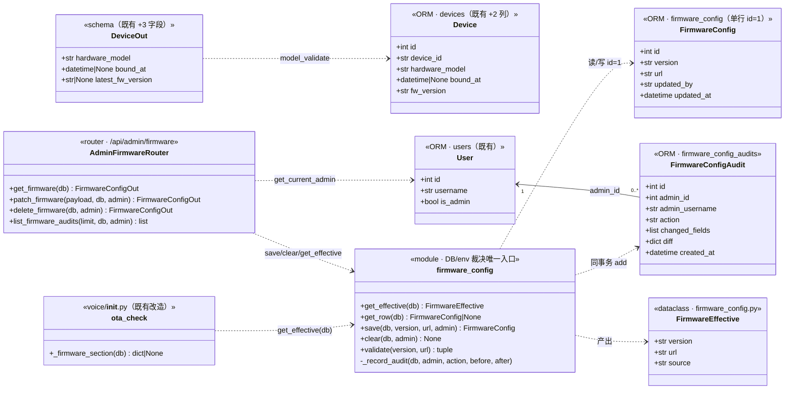
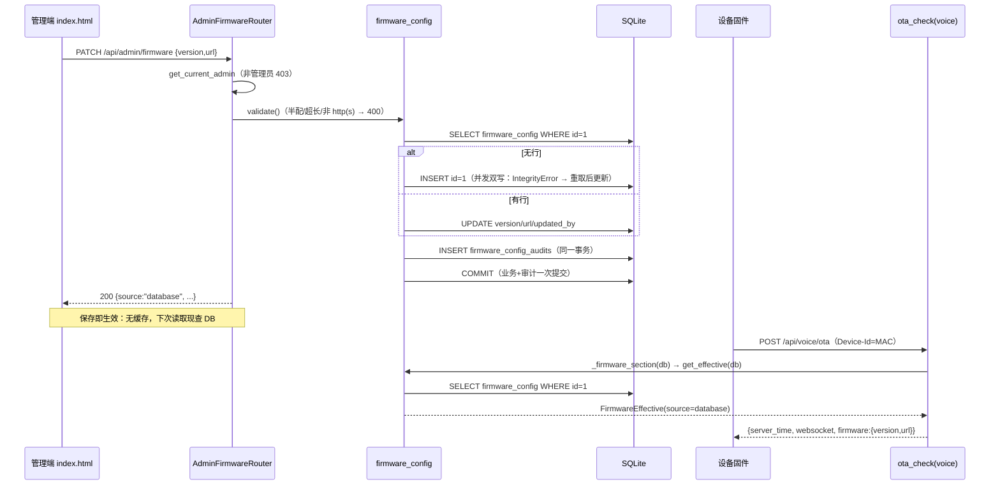
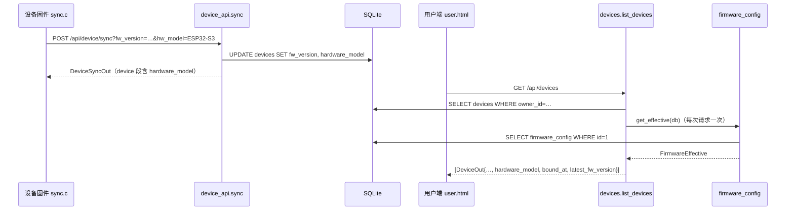

# 架构设计（增量）· OTA 配置后台化与用户端入口重构

> 本文是**增量架构设计**，对应 PRD《OTA 配置后台化与用户端入口重构》（docs/PRD-OTA后台化与用户端入口重构-2026-10-19.md）。
> 不重复《架构设计》《DEPLOY.md》已有内容。
>
> 基线：commit `2b0c58a`。文中结论区分**「事实（已读码）」**与**「推理/设计决策」**；
> 所有文件与行号均为本轮读码核实，工程师实现前如发现行号漂移，以**代码结构**为准（本仓库提交频繁）。
>
> 配套图（单独文件，沿用本仓 `-preset-admin` 命名惯例，**不覆盖**既有的通用图）：
> - `docs/class-diagram-ota-admin.mermaid`
> - `docs/sequence-diagram-ota-admin.mermaid`

---

## 0. 变更记录（2026-10-19 22:46 用户拍板，**优先于正文**）

| 项 | 原设计（正文） | 变更后（实现以本表为准） |
| --- | --- | --- |
| T01/T02/T05 的 OTA 服务端部分 | `FirmwareConfig` / `FirmwareConfigAudit` 两表、`firmware_config.py` 解析模块、`admin_firmware` router、DB 优先/env 回退裁决、审计与 DELETE 回退 | **全部暂缓，不实现**。服务端 OTA 侧零改动（`voice/__init__.py` / `config.py` 逐字未动，env 机制保留作恢复接续点） |
| 设备列表四缺口 | 硬件型号 / 绑定时间 / 固件版本列 / 升级入口（`latest_fw_version`） | 收缩为**三缺口**（硬件型号 / 绑定时间 / 固件版本列），全部落地。`DeviceOut` **不引入** `latest_fw_version` |
| `/user` 路径（T03） | 同内容直渲染，兼容期 ≥ 6 个月 | **直接删除**，不 301、不兼容渲染 |
| 管理端「OTA 固件分发」卡片 | 可配置表单（version/url + 保存/清除 + 审计弹窗） | 改为**「待开发功能」纯静态占位卡片**（无表单、无按钮、无 Vue 键） |
| T04 固件硬件型号上报 | 原样 | **保留并落地**（`hw_model` query param + `chip_model_name()`），这是三缺口之一的数据来源 |

**暂缓原因（用户原话）**：「暂时取消设备固件 OTA 功能的开发，后期可能会有很多种设备，同芯片的设备可能外围元件不同，OTA 功能开发起来太浪费时间，等到后期需要的时候再开发。这个功能可以放到管理端的 web 界面上，显示为『待开发功能』。」

**`/user` 删除依据（用户原话）**：「/user 路径可以直接删除，项目还没有对外公开，没有投入使用，所以页面不需要重定向。」

> 正文（§1 起，含 §1.2 的伪码、§2.1 的表设计、§3 的接口契约）为**过程记录**，
> 保留不删；将来恢复 OTA 后台化时它仍是可直接施工的设计底稿。
> 两条决策的完整依据与恢复接续点见 `docs/决策记录.md` D40 / D41。

---

## 1. 实现方案

### 1.1 总体判断

三项 P0 各自独立、可并行，但共享同一组服务端基础件（模型 / schema / 迁移登记 / 单一解析模块），所以任务顺序上是「先基础层、再三端并联」：

```
T01 服务端基础层（models/schemas/schema_patch/firmware_config）
 ├─► T02 服务端接口与接线（admin_firmware router / devices / device_api / voice）
 │    ├─► T03 前端双端 + 入口路由（user.html / index.html / main.py 路由块）
 │    └─► T05 冒烟与文档
 ├─► T04 固件硬件型号上报（elder_sync.h / sync.c / CMakeLists）── 与 T02 无代码依赖，仅契约依赖
 └─► T05 冒烟与文档（依赖 T02+T03+T04）
```

**新增第三方依赖：0。** 服务端全部落在既有栈内（FastAPI + SQLAlchemy + Pydantic v2）；固件用 ESP-IDF 既有的 `esp_chip_info()`。不需要动 `server/requirements.txt`。

### 1.2 P0-1 OTA 配置后台化

#### 难点与对策

| 难点 | 对策 |
| --- | --- |
| **「保存即生效」但不能加缓存** | 解析入口 `firmware_config.get_effective(db)` **每次调用现查 DB**，单行主键查询（`WHERE id=1`）。`ota_check` 本就在 `with SessionLocal() as db:` 上下文里（事实：`voice/__init__.py:210`），解析器直接复用这个 session，**不新建连接**。开销评估：SQLite 单行主键读为微秒级；`ota_check` 是设备开机级调用（非热点循环）；唯一另一个读点是用户端设备列表（UI 级低频）。**不引入缓存的理由**：缓存 = 「保存后不生效」的缺陷源，而本项目的血泪教训正是「同一事实两份真源」——缓存就是第二份真源 |
| **env 与 DB 双源的单真源问题** | **全仓只有 `firmware_config.get_effective(db)` 一个函数做「DB → env → None」的裁决**。三个消费方（OTA 段、管理端 GET、设备列表 latest_fw_version）全部调它，各自只做展示层转换，**没有任何第二处写 `if row.version else config.FIRMWARE_VERSION` 的机会** |
| **审计不能复用 `persona.admin_audit`** | 事实：`admin_audit.record()` 的签名与 `TRACKED_FIELDS` 白名单都绑定 `AIProvider` 行（`persona/admin_audit.py:53/196`），firmware_config 复用不了。对策：新建轻量审计表 `firmware_config_audits`（字段照 `AdminPresetAudit` 模式：admin_id + admin_username 快照 + action + diff JSON + created_at），记录逻辑内嵌在 `firmware_config.py`（两个标量字段的 diff，约 20 行，不值得抽象） |
| **1d 组 12 条断言的迁移** | 见 §5.1。核心事实：冒烟环境是**每次运行全新的空 SQLite**（`smoke_voice.py:99-102`，按 PID 建临时库），`firmware_config` 天然无行 → env 回退路径**天然成立**，12 条断言可以**逐字保留**；DB 路径用新增断言组覆盖（经管理端 API 保存） |

#### 与 PRD 不同的判断（1 处，理由如下）

**新增 `DELETE /api/admin/firmware`。** PRD 的 A2 判据是「删空 DB 行且配了 env → 来源显示环境变量」，但 PRD 的接口清单里只有 GET/PATCH——**没有任何产品路径能删掉 DB 行**，运维想从「数据库配置」退回「环境变量」只能手工改库。这与 P0-1 的目标（配置不再依赖改库/重启）自相矛盾。对策：加 DELETE（幂等：无行时直接 200 不写审计，与 `admin_audit.record()` 「空动作不记录」同口径），UI 上给一个「清除配置（回退环境变量）」按钮。PATCH 仍**拒绝半配与空值**（400），不与 DELETE 语义混淆。

#### 生效逻辑（伪码，唯一入口）

```python
# server/app/firmware_config.py
SOURCE_DATABASE, SOURCE_ENV, SOURCE_NONE = "database", "env", "none"
CONFIG_ROW_ID = 1   # 单行表约定，与 SmtpConfig(id=1) 一致

def get_row(db) -> FirmwareConfig | None:
    """只读、**不建行**（SmtpConfig/ChatQuotaConfig 的 get 会建行，这里刻意不建：
    「没配过」必须只有一种表示——没有行。建一条空行 = 给「未配置」造出第二种表示）"""
    return db.get(models.FirmwareConfig, CONFIG_ROW_ID)

def get_effective(db) -> FirmwareEffective:
    row = get_row(db)
    db_v = (row.version or "").strip() if row is not None else ""
    db_u = (row.url or "").strip() if row is not None else ""
    if db_v and db_u:                       # DB 两个字段都非空 → DB 优先
        return FirmwareEffective(db_v, db_u, SOURCE_DATABASE)
    env_v = (config.FIRMWARE_VERSION or "").strip()   # ⚠️ 调用时读模块属性
    env_u = (config.FIRMWARE_URL or "").strip()       # （兼容 importlib.reload，见 §5.1）
    if env_v and env_u:
        return FirmwareEffective(env_v, env_u, SOURCE_ENV)
    return FirmwareEffective("", "", SOURCE_NONE)     # 双空 → None（不返回 firmware 段）
```

`voice/__init__.py` 的 `_firmware_section()` 从「读 config 模块属性」改为「调 `get_effective`」的薄包装：

```python
def _firmware_section(db) -> dict[str, Any] | None:
    from .. import firmware_config
    eff = firmware_config.get_effective(db)
    if eff.source == firmware_config.SOURCE_NONE:
        return None
    return {"version": eff.version, "url": eff.url}
```

`ota_check` 的两个调用点（已绑定 223 行 / 未绑定 239 行，事实）改为 `_firmware_section(db)`——`db` 已在作用域内，零额外开销。

**并发与安全**：PATCH 是管理员低频操作；单行 upsert 在并发双写下靠 `db.flush()` 的 `IntegrityError` 重取兜底（§3.1 伪码）。读路径无锁。SQLite 写事务为毫秒级，不构成读取阻塞。

### 1.3 P0-2 用户端入口 `/`

**路由**（`main.py:552-564`，事实）：

| 路径 | 现状 | 改为 |
| --- | --- | --- |
| `/` | `index.html`（管理后台） | `user.html`（用户端；未登录即登录/注册页） |
| `/admin` | 不存在（404） | `index.html` |
| `/user` | `user.html` | `user.html` **原样保留**（同内容直渲染，不做 301，理由采纳 PRD Q3） |

**链接与文案**：`user.html` 两处 `href="/"` → `/admin`（125/137 行，事实）+ 1 处注释（888 行）；`index.html` 横幅 `href="/user"` → `/`（1303 行）+ 约 10 处文案/注释里的 `/user` → `/`（164/173/182/186/194/250/1249/1278/1299/1304/1384/1936/2343 行附近，事实：本轮 grep 实测比 PRD 列的 8 处多几处注释，以工程师逐处 grep `"/user"` 与 ` /user ` 为准）。

**硬编码引用排查结论（事实）**：
- **APP**（`app/src/`）：grep `/user`、`/admin` 零命中（只有内部页面路径 `pages/login/...`）。APP 走 API，不受入口切换影响。
- **固件**：`CONFIG_OTA_URL` 指向 `/api/voice/ota`、心跳走 `/api/device/sync`，全是 API 路径，不碰页面路由。
- **CI**：`server-ci.yml` 无页面路径断言；`smoke_deploy.py:219` 的 `"path": "/"` 是**合成 starlette Request 的 scope 字段**（探测 `_voice_endpoints` 用），与页面路由无关，**不要改**。
- **文档**：`docs/架构设计.md`（22/349/363/364 行）、`docs/手机APP开发说明.md`（4 行）、`docs/决策记录.md`（641/705 行附近）有 `/user` 引用，归入 T05 文档更新。

**兼容期口径**：`/user` 至少保留 6 个月直渲染；到期后改 301 → `/` 再下线。**冒烟现状（事实）**：无任何 HTTP 层断言钉这两个路径——B1 目前不可测。本设计在 `smoke_server.py` 补三条路由断言（§5.2），把 B1 从「不可测」变成「有回归网」。

### 1.4 P0-3 设备列表四缺口

| 缺口 | 方案 | 端 |
| --- | --- | --- |
| 硬件型号 | 固件 `elder_sync_cfg_t` 加 `hw_model`（NULL = 自动探测）；`sync.c` 在 `elder_sync_init` 用 `esp_chip_info()` 取芯片型号映射为展示名（`ESP32-S3` 等），心跳 URL 拼 `&hw_model=`；服务端 `Device` 加列 + `/api/device/sync` 收参落库；UI 新列。存量设备显示「未知」，下次心跳自动补全 | 固件+服务端+UI |
| 绑定时间 | `Device.bound_at`（可空，登记 schema_patch）；`routers/devices.py` **两个归属写入点**都写（见下）；UI 新列，存量「—」 | 服务端+UI |
| 固件版本列 | `DeviceOut.fw_version` 已存在（事实），纯 UI 补列 | UI |
| 升级入口 | `DeviceOut.latest_fw_version`（服务端列表/详情序列化时注入平台当前生效版本，未配置 = None）；UI「当前 → 最新」+ 重启引导；**不做服务端强制升级**（P2-4） | 服务端+UI |

#### 与 PRD 不同的判断（2 处）

1. **`bound_at` 的写入点补 `create_device`。** PRD 只点了 `devices.py:177`（bind 流程）。但事实：`POST /api/devices`（`create_device`，`devices.py:36-47`）**直接 `owner_id=user.id` 建档**（APP 扫码即归属）。只在 bind 处写 `bound_at`，会让这条路径建出的设备「已归属但绑定时间显示 —」——同一字段两种口径。对策：两个写入点都写 `dev.bound_at = models.utcnow()`。
2. **`latest_fw_version` 注入扩到 devices.py 全部四个出参点 + 说明理由。** PRD 只说列表响应。但 `create/update/get` 三个端点返回的是同一个 `DeviceOut`——只在列表注入，等于同一设备在 POST 响应里该字段为 None、在 GET 列表里有值，又是「同一事实两种口径」的微型版。对策：devices.py 内建一个私有 helper，四个端点统一走。注入方式为**整表一次查询**（不是每设备一次，避免 N+1）。

#### latest_fw_version 对普通用户可见是否可接受（论证，必答）

**可接受，且不构成新增暴露面。** 事实：`/api/voice/ota` **无鉴权**（`voice/__init__.py:177` docstring 明写），任何持 MAC 的设备开机就能拿到 `firmware:{version,url}`——平台最新固件版本号本来就是这个服务的**公开广播值**。设备列表端点是登录 + 设备归属双重保护下的读取，暴露面严格小于既有 OTA 端点。家属看到「有新版」恰恰是 US3 的诉求本身。

#### 硬件型号采集的最小固件改动（具体方案，必答）

型号字符串来源：**运行时 `esp_chip_info()`**，在 `sync.c` 内一个 `static const char *chip_model_name(void)` 完成枚举→展示名映射，`default` 分支兜底 `CONFIG_IDF_TARGET`（编译期常量，事实：`config_report.c:117` 已有同款用法），再兜底 `"unknown"`：

```c
static const char *chip_model_name(void)
{
    esp_chip_info_t info;
    esp_chip_info(&info);
    switch (info.model) {
        case ESP_CHIP_MODEL_ESP32:   return "ESP32";
        case ESP_CHIP_MODEL_ESP32S2: return "ESP32-S2";
        case ESP_CHIP_MODEL_ESP32S3: return "ESP32-S3";
        case ESP_CHIP_MODEL_ESP32C3: return "ESP32-C3";
        case ESP_CHIP_MODEL_ESP32C6: return "ESP32-C6";
        case ESP_CHIP_MODEL_ESP32P4: return "ESP32-P4";
        default:
#ifdef CONFIG_IDF_TARGET
            return CONFIG_IDF_TARGET;
#else
            return "unknown";
#endif
    }
}
```

**为什么不放在 `elder_bridge.cc` 调用侧**：bridge 是 C++ 且被 merge 进 xiaozhi main 组件，而宿主测试（`tools/test_elder_host`）只编 `elder_cmd.c`/`reminder.c`（事实：Makefile SRCS）——探测逻辑放 `sync.c` 保持 elder 组件自包含，bridge 与 `app_main.c` **零改动**（`cfg = {}` / 指定初始化器都会把新字段置 NULL = 自动探测，二进制兼容）。

**URL 安全性**：探测产出值限死于 `[A-Za-z0-9-]` 字符集（switch 常量 + `CONFIG_IDF_TARGET` 形如 `esp32s3`），天然 URL 安全，无需转义；`cfg->hw_model` 由调用方给的场景（selftest）同样约定只允许 URL 安全字符。服务端同步做 `strip()[:64]` 截断（`Device.hardware_model = String(64)`）。

---

## 2. 数据设计

### 2.1 新表（`server/app/models.py`，由 `init_db` 的 `create_all` 自动建，**不需要 schema_patch 登记**——与记忆模块六张表同例，事实见 `schema_patch.py:106-116`）

```python
class FirmwareConfig(Base):
    """平台 OTA 固件分发配置（单行表，约定只使用 id=1 那一行）。

    ⚠️ 与 SmtpConfig 的差别：读取路径**不建行**。没配过 = 表里没有行；
    建一条空行会给「未配置」造出第二种表示，而两种表示之间的裁决规则
    又会成为第二份真源。只有 PATCH 会建行，且建的时候两个字段必然非空。
    """
    __tablename__ = "firmware_config"

    id: Mapped[int] = mapped_column(Integer, primary_key=True)
    # 与 Device.fw_version 的 String(32) 对齐：版本号真源是固件 PROJECT_VER
    version: Mapped[str] = mapped_column(String(32), default="", server_default="")
    # 512 而非 128：CDN/OSS 的下载地址带签名参数时可以很长（对齐 Avatar.eaf_pack_url）
    url: Mapped[str] = mapped_column(String(512), default="", server_default="")
    # updated_by 存**管理员用户名快照**（不 join users）：改名后审计仍回答「当时是谁」
    updated_by: Mapped[str] = mapped_column(String(64), default="", server_default="")
    updated_at: Mapped[datetime] = mapped_column(
        DateTime(timezone=True), default=utcnow, onupdate=utcnow)


class FirmwareConfigAudit(Base):
    """OTA 固件配置的修改审计（逐字段 from→to）。

    为什么不复用 persona.admin_audit：那个模块的 TRACKED_FIELDS 白名单与
    record() 入参都绑定 AIProvider 行（preset_id / traits / soft_guardrails），
    给 firmware_config 复用等于把 AIProvider 的概念硬塞进一张无关的表。
    字段模式照 AdminPresetAudit：admin 快照 + action + diff + created_at。
    """
    __tablename__ = "firmware_config_audits"
    __table_args__ = (Index("ix_fw_audit_created", "created_at"),)

    id: Mapped[int] = mapped_column(Integer, primary_key=True, autoincrement=True)
    admin_id: Mapped[int] = mapped_column(
        Integer, ForeignKey("users.id"), nullable=False)
    admin_username: Mapped[str] = mapped_column(String(64), default="")
    # update / clear（DELETE 回退环境变量也记审计——「恢复」是破坏性写入）
    action: Mapped[str] = mapped_column(String(16), default="update")
    changed_fields: Mapped[list[str]] = mapped_column(JSON, default=list)
    diff: Mapped[dict[str, Any]] = mapped_column(JSON, default=dict)
    created_at: Mapped[datetime] = mapped_column(DateTime(timezone=True), default=utcnow)
```

### 2.2 `Device` 新列 + schema_patch 补丁（老库升级必登记，事实：T1 会自动差集核对）

```python
# models.py · Device（既有类内追加，位置贴近 fw_version）
hardware_model: Mapped[str] = mapped_column(
    String(64), default="", server_default="")
# 当前绑定的起始时间（重新绑定会更新）；与 created_at（设备首次登记）语义不同
bound_at: Mapped[datetime | None] = mapped_column(
    DateTime(timezone=True), nullable=True)
```

```python
# schema_patch.py · NEW_COLUMNS 追加两行（SQLite / MySQL 四元组）
("devices", "hardware_model", "VARCHAR(64) DEFAULT ''", "VARCHAR(64) DEFAULT ''"),
("devices", "bound_at", "DATETIME", "DATETIME NULL"),
```

合规性自检（对照既有纪律，事实）：
- **每行带 server_default**：`hardware_model` 带 `DEFAULT ''`（老行读出空串而不是 NULL，避免 Pydantic 序列化炸）；`bound_at` **可空**故不带默认——与 `ai_providers.owner_id`（`"INTEGER"`/`"INT NULL"`）、`deleted_at`（`"DATETIME"`/`"DATETIME NULL"`）先例一致，NULL 是合法值（`bound_at: datetime | None`）。
- **qa3_migration T1**（ORM 列 vs NEW_COLUMNS 差集，`devices` 在基线段内）：两列已登记 → 绿。
- **qa3_migration T6**（MySQL DDL 静态体检）：非 JSON 列、无 NOT NULL 缺 DEFAULT → 绿。
- **不需要 PATCH_REGISTRY 登记**：补列幂等无副作用，不改业务数据语义（`schema_patch.py:243-245` 判据）。

### 2.3 接口设计

#### 3.1 管理端 `/api/admin/firmware`（新 router：`server/app/routers/admin_firmware.py`）

router 约定（事实，照 `routers/mail.py:50-53` 与 `routers/admin_presets.py:57`）：`prefix="/api/admin/firmware"` + `dependencies=[Depends(get_current_admin)]`，非管理员 403（A5）。

**Schema**（`schemas.py` 新增）：

```python
class FirmwareConfigIn(ORMBase):
    """PATCH 入参：两个字段都必须非空（半配 = 400，A3）。"""
    version: str
    url: str

class FirmwareConfigOut(ORMBase):
    version: str = ""          # 当前生效版本（未配置为空串）
    url: str = ""              # 当前生效地址
    source: str = "none"       # database / env / none（UI 映射中文三态）
    env_version: str = ""      # 环境变量现值（供 UI 显示「env 已配但未生效」）
    env_url: str = ""
    updated_at: datetime | None = None   # DB 行的最后保存时间（env 生效时为 None）
    updated_by: str = ""                # 最后保存的管理员快照

class FirmwareAuditOut(ORMBase):
    id: int
    admin_id: int
    admin_username: str
    action: str                # update / clear
    changed_fields: list[str]
    diff: dict[str, Any]
    created_at: datetime
```

**端点**：

| 方法 | 路径 | 行为 | 响应 |
| --- | --- | --- | --- |
| GET | `/api/admin/firmware` | `get_effective(db)` + env 现值 | 200 `FirmwareConfigOut` |
| PATCH | `/api/admin/firmware` | 校验 → upsert id=1 → 审计 → **一次 commit** | 200 `FirmwareConfigOut`（source=database） |
| DELETE | `/api/admin/firmware` | 有行则删 + 审计（action=clear）；无行直接 200 | 200 `FirmwareConfigOut`（回退后的生效态） |
| GET | `/api/admin/firmware/audits?limit=50` | 按 created_at 倒序 | 200 `list[FirmwareAuditOut]` |

**PATCH 伪码**（`firmware_config.save`，审计与业务写同事务——事实：`admin_audit` 模块注释确立的「同事务一次 commit」纪律）：

```python
def save(db, version: str, url: str, admin) -> FirmwareConfig:
    version, url = validate(version, url)          # 半配/超长/非 http(s) → 400（见下）
    row = get_row(db)
    before = {"version": (row.version if row else ""), "url": (row.url if row else "")}
    if row is None:
        row = models.FirmwareConfig(id=CONFIG_ROW_ID, version=version, url=url,
                                    updated_by=admin.username)
        db.add(row)
        try:
            db.flush()
        except IntegrityError:      # 并发双建 id=1：另一个管理员刚建好
            db.rollback()
            row = get_row(db)
            row.version, row.url, row.updated_by = version, url, admin.username
    else:
        row.version, row.url, row.updated_by = version, url, admin.username
    _record_audit(db, admin, "update", before,
                  {"version": row.version, "url": row.url})   # 无变化则不记（空动作是噪音）
    db.commit()                                   # 业务 + 审计，一次提交
    db.refresh(row)
    return row

def validate(version: str, url: str) -> tuple[str, str]:
    version, url = (version or "").strip(), (url or "").strip()
    if not version or not url:
        raise HTTPException(400, "固件版本号与下载地址必须同时填写（只填一半不会生效）")
    if len(version) > 32:
        raise HTTPException(400, "固件版本号长度不能超过 32 个字符")
    parsed = urlparse(url)
    if parsed.scheme not in ("http", "https") or not parsed.netloc:
        raise HTTPException(400, "下载地址必须是 http(s):// 开头且含主机名的完整地址")
    return version, url
```

（校验放宽 http(s) 而非严格 https 的理由采纳 PRD Q5：`DEPLOY.md §1.10` 明确内网设备给内网地址；UI placeholder/说明用 https 示例引导。）

**请求/响应示例**：

```
PATCH /api/admin/firmware   {"version":"2.0.5","url":"https://152.136.230.132/firmware/xiaozhi-2.0.5.bin"}
→ 200 {"version":"2.0.5","url":"https://…/xiaozhi-2.0.5.bin","source":"database",
       "env_version":"","env_url":"","updated_at":"2026-10-19T21:30:00+00:00","updated_by":"admin"}

PATCH {"version":"2.0.5","url":""}          → 400 「固件版本号与下载地址必须同时填写…」
PATCH {"version":"2.0.5","url":"ftp://x/y"} → 400 「下载地址必须是 http(s)://…」
PATCH（非管理员 Bearer）                      → 403
```

#### 3.2 `/api/device/sync` 新 query 参数（`routers/device_api.py:97-105`，事实）

```python
@router.post("/sync", response_model=DeviceSyncOut)
def sync(request: Request, fw_version: str = "", hw_model: str = "", ...):
    ...
    if fw_version:
        dev.fw_version = fw_version
    if hw_model:                                   # 老固件不带该参数 → 不碰存量值
        dev.hardware_model = hw_model.strip()[:64]
    db.commit()
```

#### 3.3 `DeviceOut` 新字段与注入点（`schemas.py:93-110`，事实）

```python
class DeviceOut(ORMBase):
    ...  # 既有字段不动
    hardware_model: str = ""               # 存量/未上报 = 空串 → UI「未知」
    bound_at: datetime | None = None       # 存量 = None → UI「—」
    latest_fw_version: str | None = None   # 平台未配置 OTA = None → UI 隐藏升级引导
```

注入点（`routers/devices.py`，四个出参端点统一走 helper）：

```python
def _out(row: models.Device, latest: str) -> DeviceOut:
    item = DeviceOut.model_validate(row)
    return item.model_copy(update={"latest_fw_version": latest or None})

# list_devices / get_device / create_device / update_device 共用：
latest = firmware_config.get_effective(db).version   # 每次请求一次查询，整表复用
```

`DeviceSyncOut.device`（心跳响应内嵌的设备块）**不注入**：设备要比较版本走既有 `/api/voice/ota` 的 firmware 段（契约不动），该字段在 sync 响应里保持默认 None。

---

## 3. 程序调用流程

### 3.1 类图

见 `docs/class-diagram-ota-admin.mermaid`（内容同下）：



### 3.2 时序图

见 `docs/sequence-diagram-ota-admin.mermaid`（内容同下）：





---

## 4. 文件清单

> 「改什么」给到函数/区块级。行号以基线 `2b0c58a` 为准，实现时以代码结构为准。

### 服务端 · T01 基础层

| 文件 | 动作 | 改什么 | 为什么 |
| --- | --- | --- | --- |
| `server/app/models.py` | 改 | ① 新增 `FirmwareConfig` / `FirmwareConfigAudit` 两个 ORM 类（§2.1）；② `Device` 加 `hardware_model` / `bound_at` 两列 | 数据落点；新表走 create_all，老库两列走 schema_patch |
| `server/app/schemas.py` | 改 | ① 新增 `FirmwareConfigIn` / `FirmwareConfigOut` / `FirmwareAuditOut`；② `DeviceOut` 加 `hardware_model` / `bound_at` / `latest_fw_version`（全带默认值，老客户端无感） | 进出参契约；新字段可空/带默认 → 不断既有断言（smoke_home 是子集断言，事实） |
| `server/app/schema_patch.py` | 改 | `NEW_COLUMNS` 追加 `devices.hardware_model` / `devices.bound_at` 两行四元组（§2.2） | 老库升级补列；不登记 qa3_migration T1 必红 |
| `server/app/firmware_config.py` | **新建** | `get_effective` / `get_row` / `save` / `clear` / `validate` / `_record_audit` + `FirmwareEffective` dataclass（§1.2/§3.1 伪码） | **DB/env 裁决唯一入口**——本项目「同一事实两份真源」血泪教训的直接对策 |

### 服务端 · T02 接口与接线

| 文件 | 动作 | 改什么 | 为什么 |
| --- | --- | --- | --- |
| `server/app/routers/admin_firmware.py` | **新建** | GET/PATCH/DELETE `/api/admin/firmware` + GET `/api/admin/firmware/audits`；router 级 `get_current_admin`；PATCH 调 `firmware_config.save` | 管理端 API（A1-A6）；薄 router，逻辑全在 firmware_config |
| `server/app/routers/devices.py` | 改 | ① `create_device`（36-47）与 `bind_device`（177 附近）两个归属写入点加 `dev.bound_at = models.utcnow()`；② 新增私有 helper `_out(row, latest)`，`list_devices`/`get_device`/`create_device`/`update_device` 统一注入 `latest_fw_version` | C2 + C4；避免同字段在四个端点两种口径 |
| `server/app/routers/device_api.py` | 改 | `sync`（97-105）加 `hw_model: str = ""` query 参数，非空则写 `dev.hardware_model` | C1/C5；沿用 `fw_version` 的既有传参风格（PRD Q1） |
| `server/app/voice/__init__.py` | 改 | `_firmware_section()` 改签名收 `db`，内部调 `firmware_config.get_effective(db)`；`ota_check` 两处调用点（223/239）传 `db` | 保存即生效；复用既有 session，零额外连接 |
| `server/app/main.py` | 改 | `app.include_router(admin_firmware.router)`（挨着 518 行 admin_presets 注册） | 接线 |

### 前端 + 入口路由 · T03

| 文件 | 动作 | 改什么 | 为什么 |
| --- | --- | --- | --- |
| `server/app/main.py` | 改 | 路由块（552-564）：`/`→`user.html`；新增 `/admin`→`index.html`；`/user`→`user.html` 不动 | B1；`/user` 直渲染兼容（PRD Q3）。**注意：本文件在 T02 已加过 router 注册，两处编辑位置不同、无冲突** |
| `server/app/static/user.html` | 改 | ① 125/137 两处 `href="/"`→`"/admin"`；② 888 行注释更新；③ 「我的设备」表（215-242）加三列：硬件型号（`d.hardware_model\|\|'未知'`）、固件版本（`d.fw_version\|\|'未上报'` + 有更新时 `→ latest` + 小字「重启设备后将自动检查并升级」）、绑定时间（`fmt(d.bound_at)`，NULL 自动显示「—」）；列序按 PRD §5.2 | B2 + C1/C3/C4；复用既有 `fmt()`（事实：1451 行），**不新增模板标识符**→ 不触发 frontend_hygiene L2 |
| `server/app/static/index.html` | 改 | ① 横幅 `href="/user"`→`"/"`、按钮与正文文案 `/user`→`/`（1303/1304/1299）；② 约 10 处文案/注释 `/user`→`/`（164/173/182/186/194/250/1249/1278/1384/1936/2343 附近，以 grep 实测为准）；③ 「设备」tab 顶部新增「OTA 固件分发」卡片（PRD §5.1：当前生效值+来源三态、version/url 表单、保存、说明、查看修改记录弹窗）；④ 设备表加「硬件型号」列（P1，PRD Q7） | B3 + P0-1 UI + P1；新 Vue 键用 `otaForm/otaInfo/otaBusy/otaMsg/otaErr/otaAudits`（已 grep 确认 index.html 无 `ota` 前缀既有键，不会撞 L3/L4） |

### 固件 · T04

| 文件 | 动作 | 改什么 | 为什么 |
| --- | --- | --- | --- |
| `firmware/components/elder/include/elder_sync.h` | 改 | `elder_sync_cfg_t` 加 `const char *hw_model;`（注释注明 NULL = 自动探测） | 契约；既有调用方零改动（零初始化 = NULL） |
| `firmware/components/elder/src/sync.c` | 改 | ① `g` 加 `char hw_model[24]`；② 新增 `chip_model_name()`（§1.4）；③ `elder_sync_init`（706-722）填 `g.hw_model`；④ `do_sync`（613-614）URL 改 `"/api/device/sync?fw_version=%s&hw_model=%s"`，`path` 缓冲 96→192；⑤ `#include "esp_chip_info.h"` | C1 固件侧 |
| `firmware/components/elder/CMakeLists.txt` | 改 | `REQUIRES` 加 `esp_hw_support` | `esp_chip_info()` 的显式提供者（IDF 5.x）；不依赖传递依赖的隐式可见性 |
| `tools/merge_to_xiaozhi.py` | **执行**（预期无修改） | 改完 elder 组件后必须跑一次，把组件同步进 `firmware/xiaozhi/components/elder`（该目录被 .gitignore，但是 GitHub Actions 固件编译的被测代码） | 项目固件纪律（PRD §8.1） |

### 冒烟与文档 · T05

| 文件 | 动作 | 改什么 | 为什么 |
| --- | --- | --- | --- |
| `tools/smoke_voice.py` | 改 | `t_ota_firmware`（938-1022）：① 组首加「清空 firmware_config 表」（保证 12 条 env 断言测的是 env 路径）；② **12 条断言逐字保留**；③ 组尾新增 DB 断言组（§5.1 八条）；④ `finally` 补清表 + 还原 env | A7 + A1/A2/A3/A4/A5/A6 的冒烟形态 |
| `tools/smoke_server.py` | 改 | ① 新增路由断言 3 条（`/`、`/admin`、`/user` 的页面标记）；② sync 加 `hw_model=ESP32-S3` 后断言 `GET /api/devices` 的 `hardware_model`；③ bind 后断言 `bound_at` 非空；④ 断言 `DeviceOut` 三个新字段存在 | B1/C1/C2/C5 |
| `tools/smoke_home.py` | 核实（预计零改） | 其设备字段断言是**子集**形式（`<=`，事实：256-258 行），新字段不断它；跑一遍确认 | B4/C5 纪律：不许静默跳过 |
| `tools/smoke_frontend_hygiene.py` | 核实（预计零改） | L1/L2/L3/L4 全是 Vue 标识符扫描，文案/href 改动不触发；user.html 新列只用 `d.*` 与既有 `fmt()` | 同上 |
| `tools/smoke_voice_catalog.py` | 核实（预计零改） | G 组读 index.html 查音色控件标记（509-523），OTA 卡片不加音色名 | 同上 |
| `tools/smoke_ports.py` | 预计零改 | 本轮全部走**扩组既有脚本**，不起新服务、不占新端口。若工程师选择新建 `smoke_admin_firmware.py`，必须先登记 8126 | 端口纪律（PRD §8.1） |
| `docs/DEPLOY.md` | 改 | §1.10 OTA 运维口径：env 从「唯一配置途径」改为「初始值/回退」，补管理后台配置说明 + DELETE 回退路径 | 运维文档与行为一致 |
| `docs/架构设计.md` | 改 | 入口表（349 行附近）：`/`→用户端、`/admin`→管理后台、`/user` 兼容期说明；22/363/364 行 `/user` 引用更新 | 同上 |
| `docs/手机APP开发说明.md` | 改 | 4 行 `/user` 引用更新 | 同上 |
| `docs/决策记录.md` | 改（P1） | 追加一条决策：OTA 配置 DB 优先/env 回退/单一解析入口 + DELETE 回退路径 | 本仓决策记录文化 |
| `.github/workflows/server-ci.yml` | 预计零改 | 扩组既有脚本（smoke_voice/smoke_server 已在 CI 步骤里）；仅当新建脚本时才加步骤 | CI 纪律 |

---

## 5. 冒烟影响逐条核实（不许静默跳过）

### 5.1 `smoke_voice.py` 1d 组 12 条断言的迁移（必答）

**现状（事实）**：`t_ota_firmware`（938-1022）靠 `importlib.reload(app.config)` + 环境变量切换三个场景（默认无段 / 半配无段 ×2 / 配齐有段），共 12 条。DB 是每次运行全新的临时 SQLite（99-102 行）。

**迁移方案**：

1. **12 条逐字保留**。冒烟库为空 ⇒ `firmware_config` 无行 ⇒ `get_effective` 天然走 env 回退 ⇒ 「默认无段/半配无段/配齐有段」三个场景的输入输出完全不变。**组首加一句 `DELETE FROM firmware_config`** 是防御性的（保证即使本组之前有人写过行也测的是 env 路径），不是必需的。
2. **`reload` 兼容性必须保住（设计约束）**：`firmware_config.get_effective` 读 env 时必须写 `config.FIRMWARE_VERSION`（模块属性、调用时求值），**不能** `from ..config import FIRMWARE_VERSION`（import 期固化，reload 后拿不到新值——这正是现有 docstring 122-128 行解释的形态）。
3. **新增 DB 断言组**（组尾，用 `seed()` 已建的管理员现铸 `issue_user_token`，不走登录）：
   - 空库 `GET /api/admin/firmware` → `source=none`、version/url 空；
   - `PATCH` 只填 version → 400 且文案含「同时填写」（A3）；
   - `PATCH` url=`ftp://…` → 400（A4）；
   - `PATCH` 配齐 → 200 `source=database`；**不 reload** 再打 OTA，两条路径都带 DB 值（A1 保存即生效）；
   - 设 env + `reload` + DB 行仍在 → OTA 返回 **DB 值**（DB 优先）；
   - 非管理员 token `PATCH` → 403（A5）；
   - `DELETE` → 200；OTA 回落 env 值、`GET` 的 source 变 `env`（A2 的 env 分支）；
   - `GET /api/admin/firmware/audits` → 有记录且 diff 含 version/url 的 from→to（A6）。
4. **收尾**：`finally` 里清表 + pop env + reload，不给后续断言组留环境。

### 5.2 `smoke_server.py`

- 路由断言（新，补 B1 的真空）：`GET /` 响应体含 `老人陪伴提醒助手 · 用户端`（user.html:133 的 h1，事实）；`GET /admin` 含 `老人陪伴提醒助手 · 管理后台`（index.html:137/1284，事实）；`GET /user` 同样含「用户端」。两个标记串各自唯一，无歧义。
- sync 落库：`POST /api/device/sync?fw_version=1.0&hw_model=ESP32-S3` → `GET /api/devices` 断言 `hardware_model=="ESP32-S3"`（C1/C5）。
- `bound_at`：既有 bind 流程（246 行）之后断言列表项 `bound_at` 非 None（C2）。
- `DeviceOut` 新字段存在性（`hardware_model`/`bound_at`/`latest_fw_version` 三个 key 在响应里）。

### 5.3 其余脚本

- `smoke_home.py`：设备字段子集断言（256-258）+ `HomeDeviceOut` 是独立 schema（676 行）→ 预计零改，跑一遍留痕。
- `smoke_frontend_hygiene.py` / `smoke_voice_catalog.py`：静态扫描/文本标记，与本次改动无交集（前提：user.html 新列不引入新标识符、index.html 不动音色控件标记）→ 预计零改，跑一遍留痕。
- `smoke_deploy.py`：只碰 config/device_api 的地址推导，与 firmware_config 无交集 → 零改。
- `qa3_migration.py`：T1 差集会自动要求两列登记（已登记）；T6 静态体检我们的 DDL 合规；新表不在基线段不受查 → 零改，但**必须跑**（它是「忘了登记」的唯一自动防线）。
- `tools/test_elder_host`（CI elder-host-test job）：只编 `reminder.c`/`elder_cmd.c`，不编 `sync.c` → 固件改动不影响它；跑一遍留痕。
- **变异测试纪律**：新增断言必须变异实证（把 DB 优先级改反、把 bound_at 写入删掉，对应断言必须红）。

---

## 6. 任务列表（有序，按实现顺序；四组标注）

> 验收命令里的 Python 用本地 elder venv：`C:/Users/Administrator/.workbuddy/binaries/python/envs/elder/Scripts/python.exe`（下称 `$PY`）。

### T01 · 服务端基础层（数据模型 + 契约 + 单一解析模块）【服务端】P0

- **Source Files**：`server/app/models.py`、`server/app/schemas.py`、`server/app/schema_patch.py`、`server/app/firmware_config.py`（新建）
- **Dependencies**：无
- **内容**：两个新 ORM 类；Device 两列；三个新 schema + DeviceOut 三字段；NEW_COLUMNS 两行；`firmware_config.py` 全量（get_effective/get_row/save/clear/validate/_record_audit + FirmwareEffective）。
- **验收**：
  - `$PY -c "import sys;sys.path.insert(0,'server');from app import models,schemas,firmware_config;print('ok')"`
  - `$PY tools/qa3_migration.py`（T1 devices 两列登记、T6 DDL 合法）

### T02 · 服务端接口与接线（OTA 管理端 API + 设备字段服务端）【服务端】P0

- **Source Files**：`server/app/routers/admin_firmware.py`（新建）、`server/app/routers/devices.py`、`server/app/routers/device_api.py`、`server/app/voice/__init__.py`、`server/app/main.py`（仅 router 注册）
- **Dependencies**：T01
- **内容**：§3.1 四端点；bound_at 两写入点 + `_out` helper 四注入点；sync `hw_model`；`_firmware_section(db)` 改造与两调用点。
- **验收**：
  - `$PY tools/smoke_server.py 8100`、`$PY tools/smoke_home.py 8102` 全绿
  - 手验：非管理员调 `/api/admin/firmware` → 403；半配 → 400；保存后不重启打 `/api/voice/ota` 带 DB 值

### T03 · 前端双端 + 入口路由（P0-2 整特性 + P0-3/P1 UI）【前端】P0

- **Source Files**：`server/app/main.py`（路由块 552-564）、`server/app/static/user.html`、`server/app/static/index.html`
- **Dependencies**：T02（UI 依赖 T02 的 API 与注入字段）
- **内容**：路由交换；两端链接与文案；user.html 设备表三新列 + 升级入口；index.html OTA 卡片 + 审计弹窗 + 设备表硬件型号列（P1）。
- **验收**：
  - `$PY tools/smoke_frontend_hygiene.py`、`$PY tools/smoke_voice_catalog.py 8124` 全绿
  - 浏览器：`/` 出用户端登录页、`/admin` 出管理后台、`/user` 仍为用户端；OTA 卡片三态来源显示正确；设备表新列与升级引导符合 PRD §5.2

### T04 · 固件硬件型号上报【固件】P0

- **Source Files**：`firmware/components/elder/include/elder_sync.h`、`firmware/components/elder/src/sync.c`、`firmware/components/elder/CMakeLists.txt`；执行 `python tools/merge_to_xiaozhi.py`
- **Dependencies**：无（仅契约依赖 T01 的 query 参数约定；与 T02 可并行）
- **内容**：§1.4 的 cfg 字段 + chip_model_name + URL 拼装 + REQUIRES。
- **验收**：
  - `python tools/merge_to_xiaozhi.py --check`（已合入）
  - `make -C tools/test_elder_host CC=gcc` 仍全绿（宿主测试不受影响）
  - **固件编译只在 GitHub Actions**：firmware-build 工作流绿（本地无 ESP-IDF，不本地编译）

### T05 · 冒烟增强与文档【冒烟文档】P0

- **Source Files**：`tools/smoke_voice.py`、`tools/smoke_server.py`、`tools/smoke_home.py`（核实）、`tools/smoke_frontend_hygiene.py`（核实）、`tools/smoke_voice_catalog.py`（核实）、`tools/smoke_ports.py`（预计零改）、`docs/DEPLOY.md`、`docs/架构设计.md`、`docs/手机APP开发说明.md`、`docs/决策记录.md`（P1）、`.github/workflows/server-ci.yml`（预计零改）
- **Dependencies**：T02、T03、T04
- **内容**：§5 全部；新增断言必须变异实证。
- **验收**：
  - `$PY tools/smoke_voice.py 8119`（1d 组 12 条 + DB 组全绿）
  - `$PY tools/smoke_server.py 8100`、`$PY tools/qa3_migration.py`、`$PY tools/smoke_frontend_hygiene.py`、`$PY tools/smoke_voice_catalog.py 8124` 全绿

---

## 7. 共享约定（跨文件，工程师必读）

1. **`latest_fw_version` 读取入口唯一化**：全仓只有 `firmware_config.get_effective(db)` 能回答「平台当前生效的最新固件版本」。UI、OTA 段、设备列表**都不许**自己拼 `row.version or config.FIRMWARE_VERSION`。注入值为 `None` 表示「平台未配置 OTA」，**空串与 None 不允许混用**（UI 判 `None` 隐藏引导）。
2. **来源三态口径**：API 出 `database`/`env`/`none` 英文短码（与 TicketCategory 等既有枚举风格一致），UI 映射「数据库配置 / 环境变量 / 未配置」。env 生效时 UI 附变量名提示（`ELDER_FIRMWARE_VERSION` / `ELDER_FIRMWARE_URL`）。
3. **`/user` 兼容期文案口径**：兼容期内 `/user` **直渲染同内容**，全仓文案一律引导 `/`（用户端）与 `/admin`（管理端）；`/user` 只在代码注释与迁移说明里作为「兼容路径」出现。6 个月到期动作（改 301 → 下线）写进 `docs/决策记录.md`，不在代码里留定时器。
4. **硬件型号「未知」兜底文案**：`hardware_model` 为空串（存量设备 / 老固件未上报）时 UI 显示「未知」（muted）；服务端**不写**「未知」二字进库——库里的空 = 没上报过，展示层兜底。`bound_at` 为 NULL 显示「—」。
5. **半配永不生效**：PATCH 拒绝半配（400）；`get_effective` 对「行存在但字段空」同样按未配置处理（双保险）。设备侧语义不变：只有 version+url 都非空才返回 firmware 段。
6. **审计与业务写同事务一次 commit**：`firmware_config.save/clear` 内部完成，router 不再 commit；无实际变化的保存**不写审计**（空动作是噪音）但仍是 200 幂等。
7. **固件纪律**：改 `firmware/components/elder/` 后必须跑 `tools/merge_to_xiaozhi.py`；固件编译只在 GitHub Actions；新增 URL 参数必须保持 URL 安全字符集约定。
8. **时间口径**：`bound_at`/`updated_at`/`created_at` 一律 `models.utcnow()`（UTC 存储，展示层转本地）；`fmt()` 前端已有实现直接复用。

---

## 8. 待明确事项（真有歧义才列；能自己定的已定并注明）

| # | 事项 | 本设计的处置 | 理由 |
| --- | --- | --- | --- |
| Q1 | `PATCH` 是否允许「部分字段更新」？ | **不允许，两字段必须同时提交**（与「半配拒绝」A3 一致；也避免「只改 url 忘改 version」的半配态） | 半配态是 OTA 段不返回的根因，接口层就不该能造出来 |
| Q2 | 清除配置用 DELETE 还是 PATCH 空值？ | **DELETE**（本设计对 PRD 的增量，§1.2） | PATCH 空值与「必须同时填写」校验冲突；DELETE 语义明确且可审计 |
| Q3 | 审计表是否记 env 回退动作？ | **不记**。env 是部署态不是操作；只有 DB 行的 update/clear 记 | 审计回答「谁改了平台配置」，env 变更走 docker 部署记录 |
| Q4 | `latest_fw_version` 是否也要进 `/api/home/summary`？ | **不进**（HomeDeviceOut 是独立投影 schema，事实：schemas.py:676） | 首页概览不需要版本对比；加了就是第三处注入点，违背约定 1 的收敛 |
| Q5 | 管理端设备表补硬件型号列（PRD P1）排在哪？ | 放 T03 与 OTA 卡片同一次 index.html 编辑 | 同一文件同一批次，零额外成本 |

## 9. 与 PRD 的差异/细化汇总（回传要点）

1. **新增 `DELETE /api/admin/firmware`**（PRD 未列）：A2 的「删空 DB 行」否则没有产品路径可达。
2. **`bound_at` 写入点从 1 处扩到 2 处**（`create_device` + `bind_device`）：PRD 只点了 bind，漏了扫码建档即归属的路径。
3. **`latest_fw_version` 注入点从「列表」扩到 devices.py 全部四个出参端点**：避免同字段跨端点两种口径。
4. **`_firmware_section()` 改为收 `db` 参数、经 `firmware_config.get_effective` 单一入口**：PRD 说了「调用时查 DB」，本设计给出唯一入口的落点与「不缓存」的明确理由。
5. **`firmware_config` 读取路径刻意不建行**（区别于 SmtpConfig/ChatQuotaConfig 的 get 即建）：「未配置」只允许一种表示。
6. **固件探测逻辑放 `sync.c` 而非 bridge**：宿主测试只编 reminder/elder_cmd， elder 组件保持自包含；bridge/app_main 零改动。
7. **冒烟全部走扩组既有脚本**（smoke_voice + smoke_server），**不起新脚本、不占新端口、CI 零改动**；PRD §8.2 留的「可扩组或新建脚本」选择扩组。
8. **B1 补三条路由断言**（PRD 说「无 HTTP 层断言」）：现状不可测不等于应该继续不可测。
