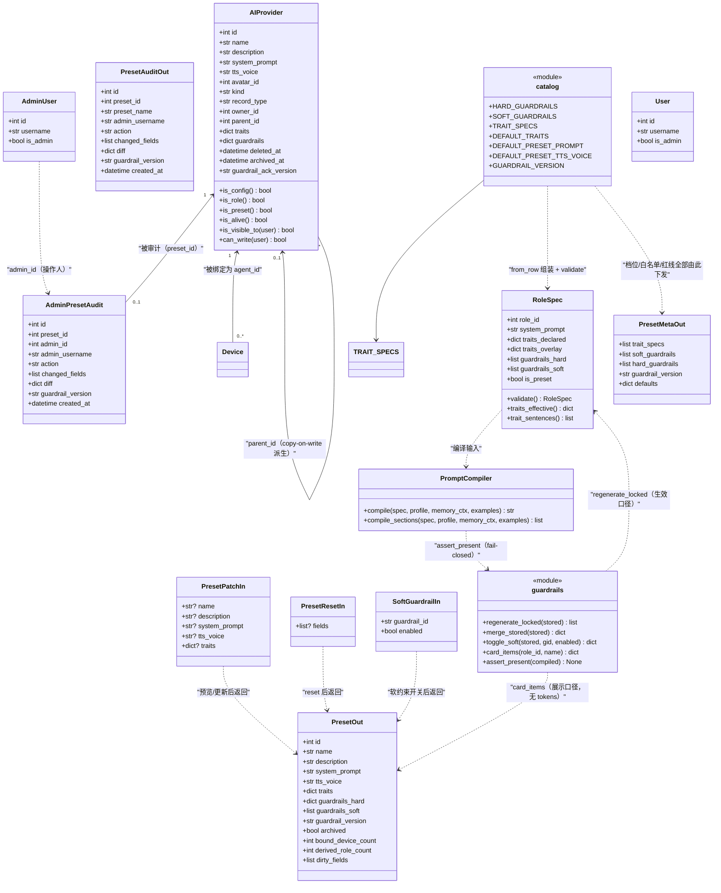
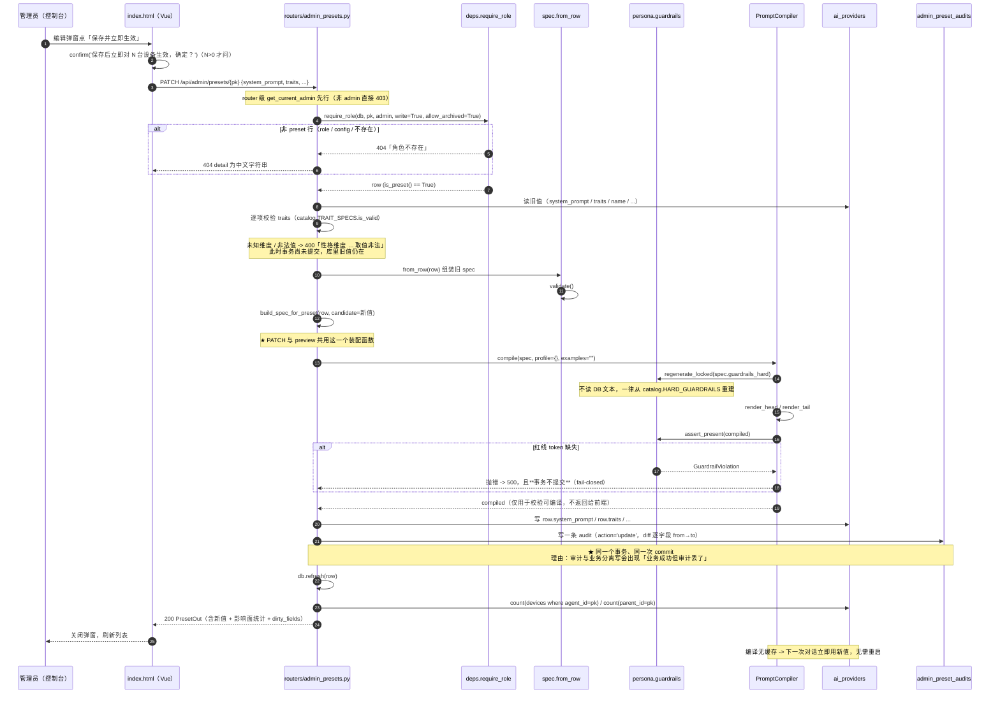
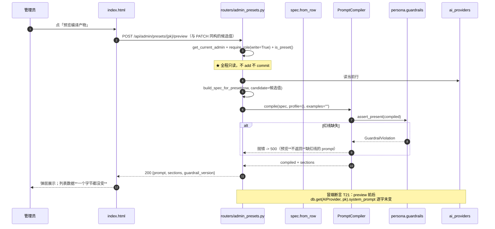
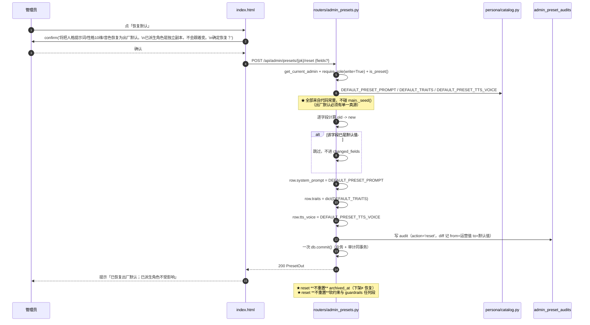
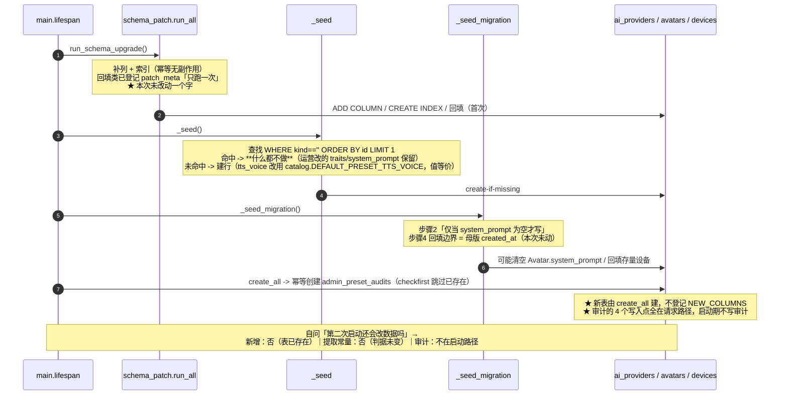

# 架构设计 · 人格预设运营后台

> 本文是**增量架构设计**，配套现有 `docs/架构设计-角色模型与人格能力.md`（角色模型）与 `docs/PRD-人格引擎与角色模型-增量.md`。
>
> **需求一句话**：运营（管理员）希望能在线调整平台人格预设，不再只能改代码 seed 发版。
>
> 上游已拍板：只做「调整现有平台预设」，不涉及用户端、不改红线机制、不引入草稿发布流。
>
> ✅ **设计已定稿**（2026-10-16）：8 项决策全部拍板，见 §15。本文档可直接作为实现依据。
>
> 本文所有现状事实均已**逐条读码复核**（§0），凡引用行号处为本轮亲自确认。

---

## 0. 现状核实（读码结论，本设计的基线）

| # | 事实 | 出处（已复核） |
| --- | --- | --- |
| A1 | 平台预设 = `ai_providers` 表里`record_type='preset'` / `owner_id IS NULL` / `kind=''` 的行；用户角色是 `record_type='role'` + `owner_id` 非空；平台 LLM 配置是 `record_type='config'` + `kind` 非空 | `models.py:229-313` |
| A2 | 权限唯一入口是四个模型方法 `is_config / is_role / is_preset / is_alive / is_visible_to / can_write`。`can_write`：preset → 仅管理员；role → owner 或管理员 | `models.py:349-384` |
| A3 | 硬红线是**代码常量** `catalog.HARD_GUARDRAILS`（5 条）+ `GUARDRAIL_VERSION="2026-10-15.1"`；编译时 `regenerate_locked(spec.guardrails_hard)` **不读 DB 文本**，`merge_stored` 写路径也先再生再落库 | `catalog.py:243-309`、`guardrails.py:69-97/243-269` |
| A4 | `render_head` / `render_tail` 都有 `items or regenerate_locked(None)` 的兜底；`assert_present()` 在返回前逐条核对 token + 首尾两个标记，缺任一抛 `GuardrailViolation` | `guardrails.py:299-327/341-371` |
| A5 | 软约束白名单 7 条在 `catalog.SOFT_GUARDRAILS`（代码常量），**只有开关、没有自定义文本**，且刻意不实现 `enforcement` 分级 | `catalog.py:316-324`、`guardrails.py:155-172` |
| A6 | traits 是**10 个独立维度**（非"三锚点"），每维 `kind ∈ {enum, number, bool}` + 值域；非法值 `validate()` 抛 `TraitValueError`，**不静默丢弃** | `catalog.py:132-214`、`spec.py:48-67` |
| A7 | preset 行的 `traits` 是**完整声明**；派生角色的 `traits` 只存 overlay，与母版叠加得生效值 | `spec.py:164-205`、`compiler.effective_traits` |
| A8 | 编译链**无任何缓存**（`compiler.py` / `guardrails.py` 无 `lru_cache`、无字典缓存）→ 改完立即生效 | 已通读两文件 |
| A9 | `RoleIn` schema **没有 guardrails 字段** → hard 段物理上无法提交；`PATCH /api/roles/{pk}` 重新校验 traits 后整体覆写，`record_type/owner_id/parent_id` 刻意不改 | `schemas.py:261-270`、`roles.py:432-469` |
| A10 | preset 的**唯一写入口是 `POST /api/roles/{pk}/archive`**（`get_current_admin`）；`DELETE`对 preset 一律 403 | `roles.py:472-569` |
| A11 | **没有"新建平台预设"的端点**：`create_role` 硬编码 `record_type='role'` / `owner_id=user.id`，不接受请求体覆写 | `roles.py:361-374` |
| A12 | `get_current_admin`：非 admin 一律 **403**（先鉴权再取行，连id 存在性都探测不到）；`require_role`：跨用户越权一律 **404** | `deps.py:46-49/78-114` |
| A13 | `_seed()` 是 create-if-missing + **永不覆盖**；查找条件 `WHERE kind=='' ORDER BY id LIMIT 1`，**不过滤 `deleted_at/archived_at/record_type`** | `main.py:88-121` |
| A14 | `_seed_migration()` 步骤 2「仅当 preset.system_prompt 为空才写」；步骤 3 清空 `Avatar.system_prompt`；步骤 4 绑定回填边界 = `preset.created_at`，比较放Python 侧并归一 UTC | `main.py:192-243` |
| A15 | `schema_patch` 三个写业务数据的函数都不碰 preset 内容字段，且已登记 `patch_meta`「只跑一次」 | `schema_patch.py:137-144` |
| A16 | `Base.metadata.create_all` 会给**新表**建表（记忆模块六张新表即靠它，未登记 `NEW_COLUMNS`） | `db.py:142`、`schema_patch.py` 模块注释 |
| A17 | 管理后台是单文件 Vue 3 全局构建版（782 行），`tabs` 数组驱动 6 个页面，统一 `api()` fetch 包装（401 清 token、非 2xx 抛 `data.detail`），错误写进 `this.err` 顶部红横幅 | `static/index.html:527-557` |
| A18 | 列表 + 弹窗表单 CRUD 的完整范本在「形象」页；危险操作用原生 `confirm()` 做二次确认 | `static/index.html:311-366/674-697` |
| A19 | 管理端API 惯例：prefix `/api/admin/<模块>`、router 级 `dependencies=[Depends(get_current_admin)]`、**不包 envelope**、创建返 201、PATCH schema 全字段 `| None = None`、detail 用**中文字符串**（前端只读 `data.detail`，dict 会显示 `[object Object]`）、无 offset分页用 `limit=Query(N,ge=1,le=M)` + 倒序 | `routers/support.py:36-42/152-163/174-201` |
| A20 | **没有管理操作审计表**。现有痕迹：`MembershipOrder.admin_id/admin_note`、`SupportTicket.admin_id/admin_reply`、`AgentPersonaAudit`（人格演化，非管理操作） | `models.py:606-640`等 |
| A21 | 端口唯一真源`tools/smoke_ports.py`，新增冒烟脚本**必须先登记**，否则 `resolve_port` 抛 KeyError；CI 在 `server-ci.yml` 里按显式端口调用 | `tools/smoke_ports.py:83-172` |
| A22 | `GET /api/roles/{pk}/prompt` 返回编译产物全文 + `sections`，鉴权 `require_role(write=True)`（preset 即仅管理员） | `roles.py:658-682` |
| A23 | `_seed()` 里 preset 的 `tts_voice="zh-CN-XiaoxiaoNeural"` 与 `description="温和陪伴风格…"` 是**裸字面量**，不在 catalog 里 | `main.py:98-99` |

---

## 1. 实现方案

### 1.1 核心难点与选型

| 难点 | 方案 | 理由 |
| --- | --- | --- |
| **运营能改的字段边界** | 白名单式`PresetPatchIn`，只 5 个字段；`guardrails.hard` **不在 schema 里**（与A9 同一手法），`record_type/owner_id/parent_id/kind/archived_at/deleted_at/is_default/avatar_id` 一律不在 | 「schema 里没有这个字段」比「校验时忽略」可靠一个数量级：前者不可能被绕过，后者会被下一个写入口漏掉。这是 `roles.py` 已验证过的手法，直接沿用同一哲学 |
| **红线在后台怎么表达** | **显示但只读**：编辑弹窗底部一个默认折叠的只读区块 + 🔒 + 版本号；API 侧走 `card_items` 口径（**不含 `tokens`**），不调`regenerate_locked` | 运营完全看不到红线会做出错误预期（"红线不存在 / 这里能改"）。但 `tokens` 是 fail-closed 自检的实现细节，暴露它等于邀请"改一下试试" |
| **改完立刻生效怎么办** | 不做草稿；提供 **`POST /preview` 不落库预览** + 编辑弹窗内实时显示影响面（绑定设备数 / 派生角色数） | 草稿表 + 发布动作 + 发布人 + 发布时间是一整套发布流，代价对应"多人协作评审"。本项目单人仓库、1 个运营，没有评审方。而"怕改坏"的真实需求用**不落库预览**就能满足——预览不产生第二套真值 |
| **多平台预设** | **本轮不支持新建**；给出将来支持时的启动逻辑处置方案（§2） | 新建会立刻引出"哪些 preset 对用户可见 /谁是平台默认 /用户端排序"这批产品问题，而当前只有"小暖"一个。且`_seed()` 的母版判据是隐含不变量，支持多预设前必须先把它显式化|
| **改了怎么回滚** | `POST /reset`，基线来自 catalog 常量；**顺带把 seed 里的裸字面量提取成 `catalog.DEFAULT_PRESET_TTS_VOICE/ DESCRIPTION`** | 否则"出厂默认"这个概念在代码里没有单一真源（prompt/traits 在 catalog、voice/description 在 main），reset 就得反向依赖 `main.py` |
| **谁改的** | 新表 `admin_preset_audits` + 逐字段 from/to diff；**硬红线与tokens 一律不入库** | 审计的价值全在"改成了什么"。不记 diff 的审计只能回答"有人动过"，那是日志不是审计 |
| **红线能不能被运营削弱** | 结构上已经不能（A3/A4）。本设计**不新增任何绕过路径**，并加断言守死 | 这条不是"设计出来的保证"，是既有结构保证。本次的职责是**别在它上面凿新洞**（例如"给运营一个 hard 段的只读展示接口"就必须小心不要顺手把 `tokens` 带出去） |

**架构模式**：沿用既有 Router → Model 单体分层，**不引入新层**。人格编译逻辑继续留在 `app/persona/`。审计写入放在 `roles.py` /新router 的**写点旁**，不抽象成"审计服务层"—— 目前只有 4 个写入点，抽一层只会让"哪个写点漏了审计"变成需要跨层排查的问题。

### 1.2 本次**不**做的事（明确划界）

| 不做 | 理由 |
| --- | --- |
| 不提供修改/删除硬红线的接口（哪怕只读展示以外的任何形态） | A3：结构上已不可改；提供一个"能提交但被忽略"的接口反而是给人假希望 |
| 不提供新增软约束 / 自定义软约束文本 | A5：白名单制是结构保证，开放文本等于开放"与红线冲突"这条路径。加新软约束 = 发版 |
| 不做草稿 / 定时生效 / 灰度 | §1.1。单运营无评审方 |
| 不新建平台预设 | §2 |
| 不改 `main.py` 的 `_seed` / `_seed_migration` 判据 | §9 |
| 不动 `is_default` / `enabled` / `avatar_id` | 都会产生"运营改了一处、影响所有人所有设备"的连锁，而这三项各有更合适的入口（角色默认 / preset 不参与下发判定 / 形象页） |
| 不给非 admin 任何人格写入口 | A12 |

---

## 2. 多平台预设：结论与处置方案

### 2.1 结论

**本轮不支持运营新建平台预设**，只支持「编辑 / 恢复默认 / 下架」现有预设。

### 2.2 为什么不支持（不是因为技术做不到）

1. **产品问题没答案**：多预设一旦上线，"用户端角色列表里官方角色区显示几个"、"谁是平台默认"、"能否把某个预设设为默认"立刻变成待答问题。这些是 PRD 级决策，不该由一个运营后台接口顺带定下来。
2. **现状只有一个预设，且它是"母版"这个特殊角色**：`_seed_migration` 的步骤 1/2/4 都以"唯一的母版"为前提（尤其步骤 4 的设备绑定回填，边界就是它的 `created_at`）。多预设不是"多几行数据"，而是**给这套迁移引入"哪一行才是母版"的判据问题**。
3. **收益不对称**：现在真正会发生的运营动作是"话太多，改温和点""加一句称呼"，全部落在 PATCH 上。新建预设的频率接近零。

### 2.3 如果将来要支持，处置方案（完整给出，供主理人拍板与后续轮次使用）

先复核现状在"多预设"下的行为（假设 id 最小的 preset = 小暖，id=1）：

| 机制 | 现状判据 | 多预设下会怎样 | 结论 |
| --- | --- | --- | --- |
| `_seed()` 是否覆盖新建的 preset | `WHERE kind=='' ORDER BY id LIMIT 1`，命中就什么都不做 | 新建行 id 更大，**永远排在第 2 位之后，不会被选中** → 不会被覆盖 ✅ | 不需要改 |
| `_seed_migration()` 步骤 1 会不会把新建行当母版 | 同上 | 同上，拿到的是 id 最小的那个 ✅ | 不需要改 |
| 步骤 4 绑定回填会不会绑错母版 | 边界 = `_seed_migration` 步骤 1 拿到的那行的 `created_at`，只给 `created_at <= boundary` 的设备回填 | 边界仍是 id 最小的那个；**新建的 preset `created_at` 更晚，永远不作为边界** → 不会绑错 ✅ | 不需要改 |
| `orphans` 提示（`main.py:259-271`） | 列出所有 `record_type='preset'` 且 `id != preset.id` 的行 | 多预设后会把**合法的新建预设**也报成 orphan 并打 warning ⚠️ | 需要改（只改日志，不改数据） |

也就是说：**`_seed()` 的"隐含不变量"当前恰好仍然成立**—— 它找的永远是 id 最小的 `kind==''` 行，多加几行更大的 id 不会改变它的选择。

但这个"恰好"不能靠运气维持。将来支持新建时，**必须同时**做两件事：

1. **把母版判据从"隐含"变成"显式"**：新增一个 `PRESET_SLUG` 概念（例如在 `ai_providers` 上加一列 `preset_key`，小暖为 `"xiaonuan"`，唯一索引；或复用 `name` 但那不可靠）。`_seed()` 改为 `WHERE record_type='preset' AND preset_key='xiaonuan'`，找不到才建。

   > 判据正确性论证（对照 `schema_patch.py` 模块顶部的两条规律）：
   > - **规律一（判据必须选写入端无条件保证的字段）**：`record_type` 是写入端无条件保证的—— `create_role` 硬编码 `'role'`，`create_provider` 硬编码 `'config'`，只有 seed 与"新建预设"端点写 `'preset'`。两侧取值必然不同 ✅ 而 `kind == ''` 对 preset 与 role **同样成立**，区分不了两者 ❌ —— 这正是 A13 那个判据今天仍在用的原因（它判的是"不是配置"）。
   > - **规律二（判据必须在同一语义空间内可比较）**：`preset_key` 与"这行是不是平台母版"同空间，可比。
2. **给 `admin_preset_audits` 加一列 `preset_id`，并在新建时写一条 `action='create'` 审计** —— 让"这个预设是谁建的"有据可查。

> ⚠️ 再次强调：`preset_key` 是 **ADD COLUMN**（新表/新列都不进 `_seed` 的业务写路径）。加了列之后 `_seed()` 那一行会**从"建"变成"按 key 找"**，属于启动期逻辑改动，必须按 §9 的论证格式走一遍（幂等性 + 判据正确性 + 二次启动不改数据）。

---

## 3. 审计表设计

### 3.1 表结构

`admin_preset_audits`（新表，`models.py` 末尾，紧邻 `PatchMeta` 但属于业务表）

| 列 | 类型 | 说明 |
| --- | --- | --- |
| `id` | Integer PK | |
| `preset_id` | Integer, FK `ai_providers.id`, index | 被改的 preset。**不设 ON DELETE** —— preset 只能 archive 不能硬删（A10） |
| `admin_id` | Integer, FK `users.id` | 操作人 |
| `admin_username` | String(64) | **快照**，不join 查。理由：用户改名后审计不能跟着变（审计要记"当时是谁"） |
| `action` | String(16), index | `update` / `reset` / `archive` |
| `changed_fields` | JSON（list[str]） | 字段名清单，便于"只查改过 system_prompt 的"这类筛选 |
| `diff` | JSON（dict） | `{"字段名": {"from": 原值, "to": 新值}}`。traits 拆成 `traits.<name>` 逐项 |
| `guardrail_version` | String(32) | 操作当时的红线版本。改红线语义后要能回答"这条改动是在哪版红线下做的" |
| `created_at` | DateTime(timezone=True), index | |

索引：`(preset_id, created_at)`、`(created_at)`。**不建 offset 分页**，与管理端惯例一致用 `limit`（A19）。

### 3.2 记什么 / 不记什么（这是本节最要紧的部分）

| 记 | 不记 | 理由 |
| --- | --- | --- |
| `system_prompt` 的完整 from/to | **任何用户派生角色的任何字段** | preset 是平台行，`owner_id IS NULL`，它身上不存在用户数据。而派生角色有 `owner_id` —— 一旦审计把派生角色的内容抄进来，`admin_preset_audits` 就成了一张跨用户数据表，且它只受 `get_current_admin` 保护，比 `ai_providers` 的行级保护更弱 |
| traits **逐维度** from/to（`traits.humor` 等 10 项） | traits 整块 JSON | 整块记的话，"只改了话多程度"和"10 项全改"在审计里长得一样，无法定位 |
| 软约束**id 列表** from/to（`["no_ads"] → ["no_ads","no_gamble"]`） | 软约束的 `text` | text 是 `catalog.SOFT_GUARDRAILS` 的代码常量值，记它等于把常量抄进可变表 |
| `name` / `description` / `tts_voice` 的 from/to | | |
| — | **硬红线正文** | 红线正文不在可改字段集合里（`PresetPatchIn` 没有它），所以 diff 里天然不会有。**但必须有一条断言守死它**：审计行的 JSON 文本里不出现 `不给医疗建议` —— 防止将来有人"顺手把展示用的 hard 段一起存进去" |
| — | **红线 `tokens`** | fail-closed 自检的实现细节。审计表是运营可读面，`tokens` 泄露等于邀请"改一个 token 试试能不能混过去" |
| — | 编译产物全文（含画像摘要、偏好示例） | 那是**运行时数据**，含用户与家属写的话。审计表绝不能成为用户内容的副本 |
| — | `record_type` / `owner_id` / `parent_id` / `kind` | 它们不可改（A9），无可记 |

### 3.3 `system_prompt` 长度上限

`system_prompt` 记全文，但设上限 **2000 字**（`RoleIn` 未限制长度，而 prompt 会逐字进 system prompt，实际也不该太长）。超过则截断并在 diff 项上打 `"_truncated": true`。理由：审计表是"变化流水"，不是"内容仓库"；无限长会让"翻最近 20 条审计"这个最常见的操作变慢。

### 3.4 写入点（4 个，全部显式）

| 写点 | action | 说明 |
| --- | --- | --- |
| `PATCH /api/admin/presets/{pk}` | `update` | 审计与业务写**同一个事务**（同一 `db.add` + 一次 `commit`）。理由：审计与业务分离写会出现"业务成功但审计丢了"，而审计丢一次就永远丢了 |
| `POST /api/admin/presets/{pk}/reset` | `reset` | 见 §4.2 |
| `POST /api/admin/presets/{pk}/soft-guardrails` | `update`（`changed_fields=["soft_guardrails"]`） | |
| `POST /api/roles/{pk}/archive`（**现有端点**） | `archive` | 在现有函数里加一行审计写入。该端点本来就是 `get_current_admin`，不新增面|

### 3.5 软约束端点的**行为变更**（必须显式承认）

现状：管理员可以通过 `POST /api/roles/{pk}/guardrails/soft` 改 preset 的软约束（`require_role(write=True)` 对 preset 放行 admin）。如果新admin 端点也提供软约束开关，就出现**两条写路径，只有一条写审计** —— 审计可以从旁边绕过，这等于审计没有。

**处置**：`POST /api/roles/{pk}/guardrails/soft` 增加一条 —— 目标 `row.is_preset()` 时返回 **403 + 中文 detail**「平台预设的软约束请在管理端调整」。admin 端点 `POST /api/admin/presets/{pk}/soft-guardrails` 内部转调同一个 `guardrails.toggle_soft` 并写审计。

> 为什么这里用 403 而不是 404（与A12 的"越权一律 404"不同）：这是**产品规则**不是安全边界 —— "平台预设的软约束归管理端管"这条规则本身就是要给管理员看的，与 preset 的 DELETE 返回 403 同理（`deps.py:75-76` 已论证过这个例外）。
>
> ⚠️ 这是**行为变更**：现状 admin 走用户端那条路是能改的。判断影响：那条路没有任何 UI 入口（管理台无角色页、APP 未接），所以实际调用方为零。

### 3.6 查询接口

`GET /api/admin/presets/{pk}/audits?limit=50` — 按 `created_at` **倒序**，返回 `list[PresetAuditOut]`。

- 鉴权：router 级 `get_current_admin`（A19）。**非 admin 403，不返回 404** —— 与 `require_config` 同口径：连"这个 preset id 存不存在"都不该泄露。
- 越权：preset 本身就是 admin 专属对象，不存在"越权访问某个 preset"的情形；`{pk}` 不是 preset 时返回 **404**（`require_role` 判 `is_role()`）。
- 响应**不包 envelope**（A19）。
- 字段：`id / preset_id / preset_name / admin_id / admin_username / action / changed_fields / diff / guardrail_version / created_at`。`preset_name` 取当前行（不存快照）—— 改名后审计显示新名是可接受的，且避免"两处名字不一致"这种更难查的问题。

---

## 4. 恢复默认（reset to default）

### 4.1 `POST /api/admin/presets/{pk}/reset`

- 入参：`{"fields": ["system_prompt", "traits"]}` **可选**，缺省 = 全部可重置字段。
- 可重置字段（**仅这 3 个**）：

| 字段 | 重置为 | 来源 |
| --- | --- | --- |
| `system_prompt` | `catalog.DEFAULT_PRESET_PROMPT` | 已在 catalog（A：`catalog.py:338-342`） |
| `traits` | `catalog.DEFAULT_TRAITS` | 已在 catalog（`catalog.py:221-223`） |
| `tts_voice` | `catalog.DEFAULT_PRESET_TTS_VOICE`（**本次新增**，值 `"zh-CN-XiaoxiaoNeural"`） | 从 `main._seed()` 的裸字面量提取（A23） |

- **不重置 `name`** —— 名字是运营给预设起的品牌标识，"恢复出厂"不该把它改回`小暖（平台预设）`。
- **不重置 `description`** —— 现状 seed 里有裸字面量，但描述是给用户看的运营文案，与"人格行为"不是一回事；重置它会让运营精心写的介绍消失。→ 因此**不提取** `DEFAULT_PRESET_DESCRIPTION`，避免为一个不重置的字段造常量。
- **不重置 `archived_at`** —— reset 与下架是两个独立动作，reset 一个已下架的预设不应把它复活。
- **不重置 guardrails 任何段** —— 硬红线本来就不在库里（只读展示），软约束**不重置**（运营自己勾的，reset 掉等于替他做决定；且勾选通常正是"上次运营做的事"）。
- traits 重置是**整体覆写为 `DEFAULT_TRAITS` 完整声明**，不做逐项合并。preset 的 traits 本来就是完整声明（A7），所以这与"清空 overlay 再合并母版"是同一件事的两种说法，但前者更直白。

### 4.2 reset 写不写审计

**写。** `action='reset'`，`diff` 记 `from`（运营改成的值）→ `to`（出厂默认值）。

理由：reset 是**一次破坏性写入**（把运营之前的所有调整抹掉）。如果不记，事后看到"预设变回默认了"这件事既不知道谁干的、也不知道之前被改成了什么 —— 这正是审计要回答的问题。"恢复动作不算变更"是日志系统的思路，不是审计的思路。

`changed_fields` 只列**实际真的被改回去的**字段（reset 时值已经等于默认值的字段不进 diff），避免审计里出现一堆空动作。

### 4.3 reset 对派生角色的影响

**零影响。** 派生是 **copy-on-write 物理复制**（`roles.py:400-415`：`system_prompt` 逐字拷贝、`traits` 从空 overlay 开始），母版之后怎么改都与它无关。这条由 `smoke_roles` 的 INV-1 与 `qa3_independence` 断言守着。

⚠️ 但**必须在 UI 上明示**，因为它反直觉：运营改母版时往往想"让所有派生角色也变温和点"，而实际上**它们一个都不会变**。UI 文案固定为：

> 恢复出厂默认只影响本预设本身。已经派生出去的角色是独立副本，不会跟着变。

反向提示同样要写：用户在自己派生角色上点「还原为预设」时，`restore_role` 会把 `system_prompt` 拷成**母版的当前值** —— 所以母版 reset 之后，那些派生角色再点一次还原，才会变成新的默认。这条链路太长，UI 上用上面那一句覆盖即可。

---

## 5. 影响面提示与预览

### 5.1 事实

编译链无缓存（A8）→ 改 preset 的 `system_prompt` / `traits` **立刻**影响所有满足以下条件的设备：

- `devices.agent_id == preset_id`，且设备未删除；
- 且该设备绑的**就是这个preset 本身**（不是某个派生角色）。

派生角色与母版无引用关系（A7 / §4.3）。

### 5.2 UI 提示（不落库的实时提示）

编辑弹窗**打开时**（`GET /api/admin/presets/{pk}` 时）返回并展示：

```
直接绑定本预设的设备：N 台 ← 改 personality 后立刻变化
已派生出去的独立副本：M 个 ← 不受影响
```

- `N > 0` 时，弹窗顶部常驻黄条：「保存后**立即**对这 N 台设备生效（系统不缓存人格，无需重启）」，保存按钮文案改为 **「保存并立即生效」**。
- `N == 0` 时黄条不出现，按钮文案回到普通「保存」。理由：无影响面时的警示是噪音，而噪音会让人习惯性忽略真警示。

### 5.3 预览：`POST /api/admin/presets/{pk}/preview`

- 入参：与 `PresetPatchIn` 同构（都是 `| None = None`），**只用于内存编译，不落库**。
- 实现：在事务内**不写任何行**，直接把候选值喂给 `spec.from_row` 的等价路径（可复用 `compiler.PromptCompiler` + `spec.RoleSpec` 手工装配），返回 `RolePromptOut` 同结构。
  -⚠️ 关键：复用 `roles.py:_spec_of` 的装配逻辑会造成"预览走一条路、真正保存后编译走另一条路"。**必须抽一个共用函数** `build_spec_for_preset(row, candidate: dict)`，PATCH 与 preview 都调它 —— 否则预览就没有"所见即所得"的意义了。
- `assert_present()` 仍然会跑（A4）：若运营把 prompt 改成导致红线缺失的内容，预览**直接报错**而不是给出一段缺红线的 prompt。这正是 `roles.py:658-666` 已论证过的行为，预览必须继承。
- 落库验证：冒烟断言「调preview 前后 `db.get(AIProvider, pk).system_prompt` 完全不变」。

### 5.4 为什么不做草稿

草稿要引入：草稿表（谁写、何时写、何时删）、发布动作、发布人、"当前生效版本"指针、以及**两个真值并存**时的行为定义（编译读草稿还是读线上？）。而本项目：单人仓库、1 个运营、`compile` 无缓存、PATCH 本身已经是即时语义。草稿解决的是"改坏了要先给别人看"，这里没有别人。

**替代品**：§5.3 的不落库预览 + §4 的 reset + §3 的审计。三者已经覆盖"改错"的三种后果（没保存就发现、保存了能回滚、回滚了能追责）。

---

## 6. 红线边界的产品表达

### 6.1 结论

**显示，只读，明确标注不可修改。** 不隐藏。

### 6.2 三条理由

1. **隐藏会制造错误预期**。运营改人格时若完全看不到红线，会推断"红线不存在"或"红线在这里能改"。前者导致运营对着一条不存在的东西提需求，后者导致运营去问"为什么我改了没用" —— 两种都是支持成本，而成本比显示高。
2. **运营需要知道"我改的东西会不会被红线覆盖/冲突"**。这是真实的高频问题：运营改 `system_prompt` 时最该知道的就是"这段话在红线框架里是什么位置"。`/preview` 返回的编译产物里红线就在正文里（A22），UI 不刻意把它挖掉反而更一致。
3. **只读展示不降低安全性**。`regenerate_locked` 的整个设计就是"DB 里的文本一律不信"（`guardrails.py:69-97`），展示什么与生效什么完全解耦。

### 6.3 展示什么（API 侧的具体约束）

编辑弹窗的数据来自 `GET /api/admin/presets/{pk}`，其 `guardrails` 字段**必须**这样构造：

```
hard = guardrails.card_items(preset.id, preset.name)["items"]
```

即 `card_items` 的口径（`guardrails.py:374-388`）：每项只有 `{id, label, text, locked: true}`。

- ⚠️ **绝不能**用 `regenerate_locked()` 构造响应 —— 它多返回 `tokens`（`guardrails.py:88-97`）。**泄漏路径写具体**：

  ```
  catalog.HARD_GUARDRAILS[i].tokens          ← 代码常量，fail-closed 自检的唯一依据
        │
        ├─► regenerate_locked(stored) ──► [ {id,label,text,tokens,locked} ]   ← 编译输入
        │        │
        │        └─► spec.guardrails_hard ──► PromptCompiler.compile()
        │                 └─► assert_present() 逐条核对 token 是否逐字出现
        │                        （缺任一 → GuardrailViolation，本轮对话失败）
        │
        └─►（误用）admin_presets.get_preset() 直接 return 它
                 └─► HTTP 响应 JSON ──► 出库到运营浏览器 / 前端 devtools / 网关日志
  ```

  动机是"给运营显示完整信息"（`regenerate_locked` 的注释里就写着"每一项带 `locked: True`，**供 UI 决定这一条不给编辑入口**"——这句话很容易让人以为它就是给 UI 用的，而实际上 `card_items` 才是）。后果不是"多暴露了一点文案"，而是把 `assert_present` 的判定基准暴露出去：攻击者/好奇者拿到 token 集合后，可反推"删掉哪一个 token 门禁就变弱"，甚至发现"保留全部 token、另加一句相反的话"这类**门禁本就挡不住的注入**（`catalog.py:258-261` 已承认该边界）。让运营知道"怎么绕"没有产品价值。

  **处置**：① 响应构造只允许调 `card_items`；② 在 `admin_presets.py` 的该处写一行注释显式说明"不要用 `regenerate_locked`，原因见设计 §6.3"；③ 断言 **T10** 守（审计/响应里不出现任一 token 字面量）。
- 前端对这些项**不渲染任何 `input` / `toggle`**，只渲染 `<div class="locked">` + 🔒。

### 6.4 UI 呈现

编辑弹窗底部：

```
▸ 安全底线（5 条 · 平台强制 · 不可修改）        ← 默认折叠，标题带 🔒
```

展开后每条：`label` + `text`。区块底部一行小字：

> 以上 5 条写死在服务端代码里（红线版本 {{guardrail_version}}），任何人都不能修改。系统在你保存时会重新生成它们 —— 即使有人绕过本页面直接改数据库也不生效。

同一区块下方紧邻软约束区（**可勾选**，7 条），底部小字：

> 软约束只能从平台固定的 7 项里勾选，不能自定义文字。新增平台软约束需要发版。

### 6.5 与承诺卡的关系

`GET /api/roles/{pk}/guardrails`（A22 的承诺卡）对 preset 已经登录后可读。所以后台显示红线**不是新增信息暴露面**。这一条要在代码注释里写明 —— 否则将来有人做"安全评审"时会误判为新增暴露。

---

## 7. 前端页面结构

### 7.1 tab 位置

插在 **「形象」之后、「AI 接入」之前**：

```
概览 / 设备 / 提醒 / 形象 / 人格预设 / AI 接入 / 统计
```

理由：人格预设与形象是同一类"给设备配置可感知属性"的页面，相邻符合运营心智；放在「AI 接入」之前是因为它比"接入"更靠近用户侧。

实现：`tabs` 数组插一个 `{k:'personas', n:'人格预设'}`（A17），页面块 `<section v-if="tab==='personas'">`。**无构建步骤**，沿用全局 Vue。

### 7.2 列表

| 列 | 内容 |
| --- | --- |
| 名称 | `name` + 下灰字 `description` |
| 状态 | 正常 / **已下架**（`archived_at` 非空 → 灰色 badge） |
| 话多程度 | `traits.verbosity` 对应档位的人话标签（由 `meta` 返回的档位表反查，**前端不硬编码文案**，A17 同源理由） |
| 绑定设备 | N 台 |
| 派生角色 | M 个 |
| 偏离默认 | 是/否 badge（对比 `DEFAULT_TRAITS` + `DEFAULT_PRESET_PROMPT`，由后端算，前端不做比较） |
| 操作 | 编辑 / 恢复默认 / 下架 / 审计 |

行内按钮用「形象」页同款 `class="row"` + `button` / `button.danger`（A18）。

### 7.3 编辑弹窗字段布局

```
┌ 编辑平台预设：小暖（平台预设） ─────────────────────┐
│ ⚠️ 保存后立即对 12 台设备生效（系统不缓存人格）        │  ← N>0 才显示
│                                                       │
│ ── 基本信息 ────────────────────────────────────────  │
│ 名称          [小暖（平台预设）              ]         │
│ 简介          [温和陪伴风格，语速偏慢…        ]        │
│ 音色          [zh-CN-XiaoxiaoNeural ▾]（下拉/输入）  │
│                                                       │
│ ── 人格提示词（家属/运营特别交代）─────────────────   │
│ [textarea 6 行]                     [预览编译产物]     │
│                                                       │
│ ── 性格 10 维 ─────────────────────────────────────  │
│ 话多程度  [很简短][简短][适中][详细]      ← 单选按钮组 │
│温和度    [很温和][温和][平和][克制]                    │
│ 爱开玩笑  [少开玩笑][偶尔][适度]                        │
│ 礼貌程度  [随意][尊重][正式]                            │
│ 主动程度  [不主动][问一句][开话题]                      │
│ 重复耐心  [换说法][主动重复][始终耐心]                 │
│ 情绪识别  [以答为主][先安慰][优先安抚]                 │
│ 话题范围  [只说用药][健康][日常家常][新闻][娱乐]        │
│ 沉默容忍  [追问一句][稍等][安静等着]│
│ 引用记忆  [开][关]                                     │
│ （每维右侧一行灰字：当前档位的行为描述，取自 meta）    │
│                                                       │
│ ── 家属额外要求（软约束 · 平台 7 项）───────────────  │
│ ☑ 不推荐任何产品、保健品、课程                          │
│ ☐ 不劝买彩票、不提赌博                    …共 7 项     │
│ 小字：只能从平台固定 7 项里勾选，不能自定义文字        │
│                                                       │
│ ▸ 安全底线（5 条 · 平台强制 · 🔒 不可修改）  ← 默认折叠│
│                                                       │
│                          [取消]  [预览]  [保存并立即生效]│
└───────────────────────────────────────────────────────┘
```

**关键：10 维 traits 绝不让运营填 0-1 浮点。** 呈现规则按 `meta` 返回的 `kind` 分派（`TraitSpec.as_option()`，`catalog.py:107-125`）：

| kind | 呈现 | 提交 |
| --- | --- | --- |
| `enum` | 单选按钮组，按钮文案 = `options[].label`（"很简短"/"简短"/…） | `options[].value` |
| `number` | 单选按钮组 = **bands 档位**（`options[].label` 就是行为描述："少开玩笑，以说正事为主。"） | `options[].value`（即 bands 的上界值，如 `0.3`/`0.6`/`1.0`） |
| `bool` | 两个按钮 开/关 | `true` / `false` |

⚠️ number 型提交的是**档位上界**（`as_option()` 对 number 型 `value` 就是 band 的 `upper`），不是让运营自由输入。这与 `to_prompt_sentence` 的分档判定（`val <= upper` 取第一个）**恰好自洽**：选"偶尔"提交 `0.6`，`0.6 <= 0.6` 命中第二档 → 渲染出的正是"偶尔可以开个小玩笑"。**若将来有人改成提交"档位下界"，同一份 traits 会渲染成另一句话** —— 这条要在前端 JS 注释里钉住。

按钮组下方那行灰字（行为描述）是本设计的核心 UX：**运营看档位名猜不出效果，看行为描述才知道自己在改什么**。全部文案由 `meta` 下发，前端零硬编码。

### 7.4 操作按钮与二次确认

| 操作 | 二次确认 | 文案 |
| --- | --- | --- |
| 编辑 | 无 | |
| 预览编译产物 | 无（弹一个新层展示 `prompt` + `sections`） | |
| 保存 | **N > 0 时确认** | `confirm('保存后立即对 N 台设备生效，确定？')` |
| 恢复默认 | **必须确认** | `confirm('将把「人格提示词 / 性格 10 维 / 音色」恢复为出厂默认。\n已经派生出去的角色是独立副本，不会跟着变。\n确定恢复？')` |
| 下架 | **必须确认** | `confirm('下架后该预设不再出现在用户的可选列表里。\n确定下架？')` |
| 审计 | 无（抽屉展开） | |

危险级别：保存是"影响他人但可秒回滚"→ 条件确认；恢复默认与下架是"不可逆/影响面结构性变化"→ 无条件确认。用原生 `confirm()`（A18 同款），不自己写弹窗。

### 7.5 审计抽屉

点「审计」在弹窗右侧拉出一个列表：时间 / 操作人 / action / 变更字段数 / 「查看」展开逐字段 from→to。`diff` 里的 `traits.*` 按维度显示成人话（用 `meta` 的档位表反查 `0.6` → "偶尔"）。

---

## 8. 测试计划

### 8.1 新增冒烟脚本

- 路径：`tools/smoke_admin_presets.py`
- 端口：**8118**，在 `tools/smoke_ports.py` 的 `DEFAULT_PORTS` 登记 `"smoke_admin_presets": 8118`（A21；8110-8117 已占）。**不登记就写脚本 → `resolve_port` 直接抛 KeyError**，这是设计上的强制。
- 启动方式沿用 `smoke_roles.py`：`guard_or_die(PORT, "smoke_admin_presets")` + 子进程 + `wait_ready`（**必须检查 `proc.poll()`**，理由见 `smoke_ports.py:198-250`）。
- CI：在 `server-ci.yml` 的 SQLite job 里，紧跟 `smoke_roles` 之后加一步 `python tools/smoke_admin_presets.py 8118`。**不加进 mysql-smoke job**（理由同现有三个 qa 脚本，见 workflow 注释）。

### 8.2 断言清单

| # | 断言 | 防的是哪类事故 |
| --- | --- | --- |
| T01 | 非 admin（普通用户 token）GET `/api/admin/presets` → **403** | 后台接口越权可读 —— 平台人格配置、影响面统计全泄露 |
| T02 | 非 admin PATCH `/api/admin/presets/{pk}` → **403**（且 detail 是中文**字符串**） | 越权改人格 = 全平台所有未派生设备的人格被篡改 |
| T03 | 非 admin 用**不存在的 pk** 调后台端点 → 仍 **403**（不是 404） | 403/404 差异泄露"这个 preset id 存在吗"（`deps.py:68-76` 已论证） |
| T04 | admin PATCH 一个 `record_type='role'` 的 pk → **404** | 把某个用户的角色误当平台预设改（`require_role` + `is_preset` 双判） |
| T05 | admin PATCH 一个 `record_type='config'` 的 pk → **404** | 把平台 LLM 配置当人格行改（P0-1 同款：改了设备全线无法对话） |
| T06 | PATCH body 里带 `guardrails: {"hard": []}` → **422** | 运营（或将来某个前端 bug）试图削弱红线。schema 里没有该字段 = 物理上不可提交 |
| T07 | PATCH body 里带 `record_type` / `owner_id` / `parent_id` → **422** | 改归属 = P0 边界（"用户角色被刷成 preset"那次事故的形状） |
| T08 | **直接改库**把 preset 的 `guardrails["hard"]` 清空，再 GET `/api/admin/presets/{pk}` 与 `GET /api/roles/{pk}/prompt` → 5 条红线齐全 | 绕过接口改库削弱红线（A3/A4 的结构防线是否还在） |
| T09 | 审计行的 `diff` JSON 文本中**不出现** `不给医疗建议` / `不能说是数字` | 有人把 hard 段展示数据一起写进审计（红线正文进可变表） |
| T10 | ① `GET /api/admin/presets/{pk}` 的响应 JSON 文本中**不出现**任一红线 token 字面量（`不给结论` / `不能说数字` / `立刻明确建议联系家人或就医` 等，全部取自 `catalog.HARD_GUARDRAILS[*].tokens`）② 审计行的 JSON 文本中同样不出现 | `regenerate_locked()` 的 tokens 随 API 出库（泄漏路径见 §6.3 图示，边界表 W12 单列）。**这条断言是防"实现时误用 `regenerate_locked` 构造响应"**—— 那两个函数签名相似、返回结构相似，而 `regenerate_locked` 的 docstring 里恰好有一句"供 UI 决定这一条不给编辑入口"，极易被误读为它就是给 UI 用的 |
| T11 | PATCH `traits={"humor":"很好笑"}` → **400**，且随后 GET 详情 `traits.humor` 仍是原值 | 非法值落库 → 该 preset 是全平台共享行，脏值会让**所有用户**的角色列表 400（A6 + `_list_spec_of` 的降级只在读路径，写路径必须拦住） |
| T12 | PATCH `traits={"unknown_dim": 1}` → **400** | 未知维度落库，同上 |
| T13 | PATCH 合法 traits 后，`GET /api/roles/presets` 仍 **200** | 后台写路径产出的数据打挂了用户端主链路 |
| T14 | PATCH 之后**重启服务**，再 GET 详情 → 值仍在 | 启动流程覆盖运营修改（A13/A14 的既有保证被本次改动破坏）—— 这是本设计**最重要的一条回归断言**，因为一旦破坏，运营的所有调优都会在下次重启时静默消失 |
| T15 | PATCH 之前先派生一个角色；PATCH 母版后GET 该派生角色 → `traits` / `system_prompt` / `traits_effective` 全不变 | 误以为母版改动会穿透到派生角色（copy-on-write 被破坏） |
| T16 | 同上，但 `GET /api/roles/{derived}/diff` 的 `changed_count` 不变 | 同上（diff 走的是母版声明求差集，母版变了 diff 必然变 —— **这条断言确认了"diff 会显示母版新值而 current_value 仍是派生自己的值"这一预期行为**，不是 bug） |
| T17 | `POST /reset` → `traits == catalog.DEFAULT_TRAITS` 且 `system_prompt == catalog.DEFAULT_PRESET_PROMPT` | reset 不生效 / 基线取错来源 |
| T18 | `POST /reset` 后审计新增一条 `action='reset'`，`diff` 的 `to` 等于默认值 | 恢复动作无痕 —— 事后无法回答"谁把预设改回默认的、之前改成了什么" |
| T19 | 对一个已经是默认值的 preset 调 `reset` → `changed_fields` 为空数组（不产生空动作审计） | 审计被空动作淹没 |
| T20 | 每次 PATCH 审计的 `changed_fields` 与实际变更字段**精确一致**（不多不少） | 审计记了没变的字段（diff 噪声）或漏了变了的字段（审计说谎） |
| T21 | `POST /preview` 返回的 prompt 含首尾两个 `【安全底线 · 不可协商】` 标记，且 preview 前后 DB 里 `system_prompt` **逐字未变** | 预览偷偷落库（"预览"变成"草稿"，用户以为没保存其实改了） |
| T22 | preview 提交一个会导致红线缺失的内容 → 返回错误而非缺红线的 prompt | 预览绕过 fail-closed，运营看到"这就是机器人现在的全部设定"而它其实没带红线（`roles.py:662-666` 已论证过这个具体危害） |
| T23 | `POST /api/roles/{pk}/guardrails/soft`（admin token，目标 preset）→ **403** | 绕过 admin 端点改软约束 → **审计可被从旁边绕过**（§3.5） |
| T24 | `POST /api/admin/presets/{pk}/soft-guardrails` → 生效，且审计 `changed_fields == ["soft_guardrails"]` | 软约束改动无审计 |
| T25 | `POST /api/roles/{pk}/archive` → 审计新增 `action='archive'` | 下架无审计（下架是结构性变化，最需要留痕） |
| T26 | 有派生角色或设备绑定时 archive → **409**（含引用清单） | 硬删/下架母版让 `parent_id` 悬空 |
| T27 | archive 之后**重启服务** → 该 preset 仍是 `archived_at` 非空，且**preset 行数不增加** | 有人"修" `_seed()` 时加了 `archived_at` 过滤 → 每次重启凭空多一个新 preset（比"不重建"更糟：库里会堆积重复的"小暖"） |
| T28 | `GET /api/admin/presets/meta` → 恰好 10 个 trait 维度（kind 齐备 enum/number/bool 三类都有）、7 条软约束、5 条红线、`guardrail_version == GUARDRAIL_VERSION` | 前端硬编码档位文案 → 加/删档位后后台显示错位（`catalog.py:10-12` 已论证前端不得硬编码） |
| T29 | `GET /api/admin/presets/{pk}/audits?limit=1` → 最多 1 条，且按时间倒序 | 分页参数失效返回全量（未来数据量大了会打挂页面） |
| T30 | 后台端点响应**不含** envelope 包装（直接是数组/对象），且所有 4xx 的 `detail` 是**字符串** | 前端 `api()` 抛 `new Error(data.detail)`，dict 会渲染成 `[object Object]`（A19 + A17） |

---

## 9. 与启动期写表机制的交互

### 9.1 本次**不改** `schema_patch.py`

- `admin_preset_audits` 是**新表**，`Base.metadata.create_all` 会建（A16；与记忆模块六张新表同理由）。**不登记 `NEW_COLUMNS`**（那是给"表已存在但缺列"准备的，`NEW_COLUMNS` 登记项必须是 `ALTER TABLE ADD COLUMN`）。
- `PATCH_REGISTRY` **不新增条目** —— 本次没有任何启动期改业务数据的逻辑，没有东西需要"只跑一次"守卫。
- 现存三个改业务数据的函数（`backfill_record_types` / `dedupe_persona_globals` 等）**一个字都不动**。

### 9.2 本次**不改** `main.py` 的 `_seed` / `_seed_migration` 判据

理由见 §2.3：现状判据在"本轮不新建预设"的前提下与新需求完全兼容，且多预设下仍恰好正确。

**唯一一处触碰 `main.py` 的改动是提取常量**：

```
main._seed() 里：
- description="温和陪伴风格，语速偏慢，适合老年用户"   （不动）
- tts_voice="zh-CN-XiaoxiaoNeural"  →  catalog.DEFAULT_PRESET_TTS_VOICE
```

**幂等性与判据正确性论证（按铁律格式）**：

| 问 | 答 |
| --- | --- |
| 这次改动**改业务数据**吗？ | **不改**。它把一个字面量换成一个等值常量，值相同、写入时机相同（`_seed()` 只在 `preset is None` 时建行） |
| 第二次、第一百次启动会改数据吗？ | **不会**，且这一点本次改动前后**完全一致** —— 因为 `_seed()` 判据与建行条件都没动 |
| 判据正确性变了吗？ | **没变**，判据一个字符都没改 |
| 老库（已有 preset 行）会被影响吗？ | **不会**。`_seed()` 对已存在的行**什么都不做**（A13），提取常量后老库仍是老值 |
| 新库（`preset is None`）呢？ | 新库拿到的值与改前**逐字相同**，行为等价 |

**结论**：这不是"启动期改业务数据"，只是常量搬家。之所以仍写上面的论证表，是因为这条路径历史上正是 P0 的发源地 —— **`_seed()` 里的任何改动都必须走一遍这张表**，哪怕看起来无害。

### 9.3 幂等性总述（本次全部改动的自问）

> 自问「第二次、第一百次启动时还会改数据吗？」

| 改动 | 答案 |
| --- | --- |
| 新增审计表 | 表结构由 `create_all` 建，第二次启动 `checkfirst` 跳过 → 不改数据 |
| catalog 提取常量 | 不改数据（§9.2） |
| 4 个审计写入点 | 全在**请求路径**（HTTP handler），不在启动路径 → 不改数据 |
| schema_patch / PATCH_REGISTRY | 未改 |

**本次设计对启动期写表机制的净改动 = 0。**

---

## 10. 数据结构与接口（Mermaid classDiagram）



> 图中 `AdminUser` 与 `User` 合并为同一个 `User` 即可（`get_current_admin` 返回的就是 `models.User`）；保留两行只为表达"审计记的是快照用户名"。

---

## 11. 程序调用流（Mermaid sequenceDiagram）

### 11.1 PATCH 更新平台预设（含审计同事务写入）



### 11.2 preview（不落库）



### 11.3 reset（恢复出厂默认）



### 11.4 启动流程（本次改动后，净改动 = 0）



---

## 12. 文件清单

| 文件 | 动作 | 说明 |
| --- | --- | --- |
| `server/app/catalog.py` → `server/app/persona/catalog.py` | 改 | 新增 `DEFAULT_PRESET_TTS_VOICE`（值取自 `main._seed()`） |
| `server/app/main.py` | 改 | `_seed()` 的 `tts_voice` 改引用常量（值不变）；注册新 router。**判据不动** |
| `server/app/models.py` | 改 | 新增 `AdminPresetAudit` 模型 |
| `server/app/schemas.py` | 改 | 新增 `PresetOut` / `PresetPatchIn` / `PresetResetIn` / `SoftGuardrailIn` / `PresetMetaOut` / `PresetAuditOut` / `PresetListOut` |
| `server/app/routers/admin_presets.py` | **新增** | 管理端 router（7 个端点） |
| `server/app/routers/roles.py` | 改 | ① `archive_role` 加审计写入 ② `toggle_soft_guardrail` 对 preset 返回 403 ③ 抽出共用的 spec 装配函数 |
| `server/app/static/index.html` | 改 | 新增 `personas` tab + 列表 + 编辑弹窗 + 审计抽屉（约 +260 行） |
| `server/app/persona/admin_audit.py` | **新增** | 审计写入的共用 helper：`record(db, admin, row, action, before, after)`。**主理人已拍板独立成文件**（2026-10-16）：4 个写入点共用一个 diff 格式化函数，才能保证「不漏写、格式一致」；内联进 models.py 会让审计格式逻辑与 1200 行模型定义缠在一起，将来想查"审计里到底记了什么"要翻遍 models。**文件头注释必须写清**：「本模块只负责审计记录的组装与写入，**不含任何业务判定**（字段是否可改、值是否合法一律由调用方裁决）」 |
| `tools/smoke_admin_presets.py` | **新增** | 见 §8 |
| `tools/smoke_ports.py` | 改 | 登记 `"smoke_admin_presets": 8118` |
| `.github/workflows/server-ci.yml` | 改 | SQLite job 加一步（**不进 mysql job**） |
| `docs/class-diagram-preset-admin.mermaid` | 新增 | §10 类图的独立文件。**不覆盖 `docs/class-diagram.mermaid`** —— 那份归属角色模型文档 |
| `docs/sequence-diagram-preset-admin.mermaid` | 新增 | §11 四条时序的独立文件，同上 |
| `docs/架构设计-人格预设运营后台.md` | 新增 | 本文 |

---

## 13. 端点清单

| # | 方法 + 路径 | 鉴权 | 请求 | 响应 |
| --- | --- | --- | --- | --- |
| 1 | `GET /api/admin/presets` | `get_current_admin` | `limit: int = Query(50, ge=1, le=200)` | `PresetListOut{presets: [PresetOut]}`，按 `id` **倒序**（新建的在前；本轮无新建但先定死） |
| 2 | `GET /api/admin/presets/meta` | `get_current_admin` | 无 | `PresetMetaOut`（10 维档位 / 7 条软约束 / 5 条红线 / `guardrail_version` / `defaults`）。**⚠️ 必须声明在 `/​{preset_pk}` 之前**，否则 `meta` 会被当 int 解析 422 |
| 3 | `GET /api/admin/presets/{preset_pk}` | `get_current_admin` + `require_role(write=True)` + `is_preset()` | 无 | `PresetOut`（含影响面计数、`dirty_fields`、只读红线） |
| 4 | `PATCH /api/admin/presets/{preset_pk}` | 同上 | `PresetPatchIn`（5 字段全 `| None`） | `PresetOut`；非 admin 403，非 preset 404，traits 非法 400 |
| 5 | `POST /api/admin/presets/{preset_pk}/preview` | 同上 | `PresetPatchIn` | `RolePromptOut` 同结构。**不落库** |
| 6 | `POST /api/admin/presets/{preset_pk}/reset` | 同上 | `PresetResetIn{fields?: list[str]}`（缺省=3 个可重置字段） | `PresetOut`。`fields` 含未知项 → **400** |
| 7 | `POST /api/admin/presets/{preset_pk}/soft-guardrails` | 同上 | `SoftGuardrailIn{guardrail_id, enabled}` | `PresetOut`。未知 `guardrail_id` → **400**（`toggle_soft` 抛 ValueError） |
| 8 | `GET /api/admin/presets/{preset_pk}/audits` | `get_current_admin` + `require_role(write=True)` | `limit: int = Query(50, ge=1, le=200)` | `[PresetAuditOut]`，`created_at` **倒序** |
| — | `POST /api/roles/{preset_pk}/archive` | 现有 `get_current_admin` | 无 | 现有。**本次仅加审计写入** |
| — | `POST /api/roles/{preset_pk}/guardrails/soft` | 现有 | 无 | **行为变更**：目标为 preset 时 **403 + 中文 detail** |

### 13.1 `PresetPatchIn` 字段白名单逐项依据

| 字段 | 可改 | 依据 |
| --- | --- | --- |
| `name` | ✅ | 纯展示字符串，进 prompt 的身份段（`_section_identity`）。运营必须能改 |
| `description` | ✅ | 同上，且是用户端角色列表展示的内容 |
| `system_prompt` | ✅ | **这正是运营后台的核心需求**。它是"软性"描述（红线由代码常量注入，不在这里 —— `catalog.py:335-337` 已论证） |
| `tts_voice` | ✅ | 音色是人格感知的一部分，且 seed 里就带默认值；reset 需要它 |
| `traits` | ✅ | 运营调人格的主入口；**整体覆写**（与 `roles.py:452-464` 同一语义）。partial 语义会让"取消勾选"无法表达 |
| `guardrails.hard` | ❌ | **schema 里没有 `guardrails` 字段** → 422，物理上不可提交。编译期 `regenerate_locked` 再兜一层（A3） |
| `guardrails.soft` | ⚠️ 单独端点 | 不放进 PATCH。理由：软约束是"勾选型"操作，若并入整体覆写，"忘带这个字段 = 全部清空"会成为可能；且它需要独立审计条目 |
| `record_type` / `owner_id` / `parent_id` / `kind` | ❌ | 归属与派生关系。改归属必须走显式路径 —— A9 的注释明写"这是 P0 安全边界，不能靠 PATCH 顺手改掉" |
| `archived_at` / `deleted_at` | ❌ | 生命周期。下架走 archive（A10），删除接口对 preset 永远 403 |
| `is_default` | ❌ | 它是"APP 新建角色时的默认选中"，不是"平台默认人格"。改它会让**所有用户的默认角色**静默变化，而运营想改的往往不是这个 |
| `enabled` | ❌ | preset 行不参与任何下发判定（`is_config()` 才参与），改它是死字段，只会制造"我关了它怎么没变"的困惑 |
| `avatar_id` | ❌ | 形象是另一套生命周期（自己的 `record_type/owner_id/软删`），且形象页已能编辑。让人格页改 `avatar_id` 会造成"这里能改、下架语义却不知道"的不一致 |
| `guardrail_ack_*` | ❌ | 那是**用户**的确认回执（角色级事件），运营替用户确认是造假 |

---

## 14. 边界表：本次设计守得住什么 / 守不住什么

### 14.1 守得住（且有断言钉着）

| # | 性质 | 靠什么守住 | 断言 |
| --- | --- | --- | --- |
| S1 | 运营**改不了硬红线** | ① `PresetPatchIn` 无 `guardrails` 字段（422）② 编译期 `regenerate_locked` 不读 DB 文本 ③ `assert_present` fail-closed ④ 后台只读展示走 `card_items`，**不带 `tokens`** | T06 / T08 / T09 / **T10**（④ 这条的具体泄漏路径见 §6.3 与 **W12**） |
| S2 | 运营**改不了归属**（record_type / owner_id / parent_id / kind） | `PresetPatchIn` 无这些字段（422） | T07 |
| S3 | 非 admin **进不来**后台 | router 级 `get_current_admin`（先鉴权后取行，403 不泄露 id 存在性） | T01 / T02 / T03 |
| S4 | **平台 LLM 配置不会被当人格行改** | `require_role` 判 `is_role()` + 显式 `is_preset()` 双判 → 404 | T05 |
| S5 | **用户角色不会被当成平台预设** | 同 T04 | T04 |
| S6 | 运营修改**重启后仍在** | `_seed()` create-if-missing 永不覆盖 + `_seed_migration` 步骤 2"仅当为空才写" | **T14** |
| S7 | **派生角色不被母版改动影响** | copy-on-write 物理副本，编译无引用 | T15 / T16 |
| S8 | 脏 traits **进不了库**、也**打不挂用户端** | 写前逐项 `is_valid` + 400，且事务未提交 | T11 / T12 / T13 |
| S9 | 软约束**只能从 7 条白名单里选**，不能自定义文本 | `toggle_soft` 未知 id 抛错 → 400；文本恒取自 `catalog.SOFT_GUARDRAILS` | T24 |
| S10 | 软约束**改动无法绕过审计** | 用户端 toggle 端点对 preset 一律 403，唯一写路径是 admin 端点且写审计 | T23 / T24 |
| S11 | 下架**不会让 `parent_id` 悬空** | 现有 409 + 引用清单 | T26 |
| S12 | 已下架预设**不会因重启复活、也不会被凭空复制** | `_seed()` 不过滤 `archived_at`（现状行为），有派生/设备绑定时 archive 直接 409 | **T27** |
| S13 | 每次改动**可追溯到人/时间/前后值** | `admin_preset_audits` 与业务写同事务 | T18 / T19 / T20 / T25 |
| S14 | reset **不复活已下架预设**、不覆盖运营自己勾的软约束 | reset 只写 3 个字段 | T17 + 手工核对 |
| S15 | 审计表**不含用户数据、不含红线正文与 tokens** | 设计约束 + 显式断言 | T09 / T10 |
| S16 | **启动期写表机制净改动 = 0** | 未动 `schema_patch` / `PATCH_REGISTRY` / `_seed` 判据 | §9 自问表 |
| S17 | 新增冒烟**不撞端口** | 先在 `smoke_ports.py` 登记，`_assert_unique()` import 期自检 | 脚本能启动即通过 |

### 14.2 守不住（必须让运营与主理人知道）

| # | 守不住的事 | 为什么 | 缓解 / 谁来兜 |
| --- | --- | --- | --- |
| W1 | **运营把人格改到极差的效果** | `system_prompt` 与 traits 是自由文本/值域，**没有任何机制能判断"这句话对老人是否合适"**。结构上只能保证红线在，不能保证人格好 | `preview`（改前肉眼审）+ 影响面黄条 + 秒级reset + 审计追责。**这是运营责任，不是系统能解的** |
| W2 | **编译产物里的红线不保证 prompt 语义正确** | `assert_present` 只做**字面 token 存在性**检查，挡不住"保留全部 token、另加一句相反的话"（`catalog.py:258-261` 已明确承认） | 运营写 `system_prompt` 时**理论上可以写一句与红线矛盾的话**而门禁仍绿。本设计**没有**新增机制去堵它 —— 要堵需语义模型，成本与延迟不可接受。→ UI 上必须有一句常驻提示："不要在人格提示词里写与安全底线冲突的内容" |
| W3 | **`system_prompt` 可以被运营写成 prompt 注入** | 它逐字进 system prompt（只做 `_clean` 长度限制，不做语义过滤） | 与 W2 同源。缓解：`spec.py` 的 fail-closed 哲学 + 运营审核。**本设计不假装解决了它** |
| W4 | **审计可以被直接改库抹掉** | 单人仓库、无审计链签名。库在运营手里 | 备份与 DB 权限。代码层只能做到"没有接口能改审计表" |
| W5 | **审计只覆盖这 4 个写点** | 直接 `sqlite3` 改库不留痕 | 与 W4 同源 |
| W6 | **两管理员并发改同一 preset 会互相覆盖**（后写胜） | 无乐观锁 / 无 `updated_at` 版本号 | 单运营场景下不发生。将来多运营需要加 `If-Match` 或 version 列 |
| W7 | **`is_default` 不可改这件事没被界面解释** | 运营可能想"设小暖为默认人格" | 本设计选择**不做** `is_default`（§13.1）。若产品确实需要，是**独立一轮**（要连带想清"用户派生角色的默认预设是谁"） |
| W8 | **不做多预设** | §2。**已拍板**（§15 #1）本轮不做 | 将来要做，按 §2.3 的方案先给 `_seed()` 换显式母版判据 |
| W9 | **编译无缓存带来的"改了立刻生效"没有撤销窗口** | A8 是设计选择 | `reset` 是唯一的撤销手段，且不保留中间版本（只有审计里有 from 值，**UI 上暂不提供"一键回到某个历史版本"**） |
| W10 | **`preview` 与真正保存后的编译结果可能因后续重构而分叉** | 两者共用 `build_spec_for_preset` 才安全 —— 这是**约定**，不是结构保证 | 断言 T21 只能验"没落库"，验不了"共用同一装配函数"。→ 代码评审 checklist 必查项；建议在 `build_spec_for_preset` 的 docstring 里写明"PATCH 与 preview 都必须调它" |
| W11 | **审计 `system_prompt` 截断到 2000 字** | 防止审计表膨胀 | 超长内容只能看到前2000 字。设计上接受（人格提示词不该那么长） |
| **W12** | **红线 `tokens` 可能随 API 出库** | `regenerate_locked()` 的返回值是**直接进 `spec.guardrails_hard` 的编译输入**（`guardrails.py:88-97` → `spec.py:201`），而它的 docstring 里那句"供 UI 决定这一条不给编辑入口"很容易让人误以为它就是给 UI 用的——实际上给 UI 的是 `card_items`（`guardrails.py:374-388`）。任何人为了"显示完整信息"误用它构造响应，token 集合就随 JSON 出库到浏览器 / devtools / 网关日志，后果是把 `assert_present` 的判定基准暴露给攻击者（可反推"删哪个 token 门禁变弱"，并顺带发现"保留全部 token 另加一句相反的话"这类门禁本就挡不住的注入） | 三重：**①** 代码层只允许调 `card_items`（§6.3）；**②** 构造响应的那行必须写注释指回 §6.3；**③** 断言 **T10** 守（响应与审计里都不出现任一 token 字面量）。**本条是"设计上守住了"但"实现时极易踩"，故单列** —— S1 只把它列为四道防线之一，不足以表达这个具体泄漏路径 |
| W13 | **`traits` 的 number 型提交的是档位上界** | `as_option()` 对 number 型返回 `value = bands 的 upper`，而 `to_prompt_sentence` 的分档判定是 `val <= upper` 取第一个。两者恰好自洽，但**若将来有人改成提交"档位下界"，同一份 traits 会渲染成另一句话** —— 而值域校验（`is_valid`）仍然通过，**没有任何断言会红** | 前后端各一条注释钉住语义；`meta` 下发档位表时把 `value` 的含义（"这是上界"）写进字段说明。断言 T11/T12 只验值域不验分档（**这条边界要写明：分档一致性目前靠注释而非断言**）。设计上接受这个耦合：**它换来了"运营永不接触 0-1 浮点"**（§7.3） |

---

## 15. 拍板记录

> **2026-10-16 主理人评审：7 项待决全部采纳本文建议。** 本节改为记录最终决议，供工程师直接照做。

| # | 待决 | 决议 | 落实位置 |
| --- | --- | --- | --- |
| 1 | 是否支持运营新建平台预设 | **本轮不支持**。若将来要支持，须先给 `_seed()` 换**显式**母版判据（`preset_key`），并按 §9 的铁律格式重走论证 | §2.3（方案已备好） |
| 2 | `description` 是否纳入 reset | **不纳入**（运营的品牌文案，不是人格行为） | §4.1 |
| 3 | `POST /api/roles/{pk}/guardrails/soft` 对 preset 返回 403（**行为变更**） | **做**。不做则审计可被绕过，等于审计失效 | §3.5 / `roles.py` 的 `toggle_soft_guardrail` |
| 4 | 审计 `system_prompt` 上限 2000 字 | **采纳** | §3.3 |
| 5 | UI 是否显示硬红线 | **显示、只读、默认折叠** | §6.4 |
| 6 | 「保存」在 `N > 0` 时是否确认 | **要**（条件确认）；`N == 0` 时不问，避免警示疲劳 | §7.4 |
| 7 | `card_items` 不含 `tokens` 的展示口径 | **采纳**。这是 §6.3 与 T10 的唯一依据 | §6.3 / §6.3 泄漏路径图 |
| 8 | `persona/admin_audit.py` 是否独立成文件 | **独立成文件**（主理人裁定）。文件头注释须写明「本模块只负责审计记录的组装与写入，**不含任何业务判定**」 | §12 |

### 15.1 关于待决 3 的复核（主理人亲自读码确认）

主理人复核确认该绕过口成立且比我原先描述的更值得强调：

- `roles.py:707-720` 的 `toggle_soft_guardrail` 用 `require_role(write=True)`；
- `models.py:213-217` 的 `can_write` 对 preset 是 `bool(user.is_admin)`；
-⇒ **任何管理员走用户端点 `/api/roles/{pk}/guardrails/soft` 就能改平台预设的软约束，`admin_preset_audits` 里一条记录都不会留**。

这不是"将来可能的风险"，而是**审计机制一上线就存在的真实绕过口**。因此 **断言 T23（用户端端点对 preset 必须 403）是 S10 的唯一守护**，不可省略。
